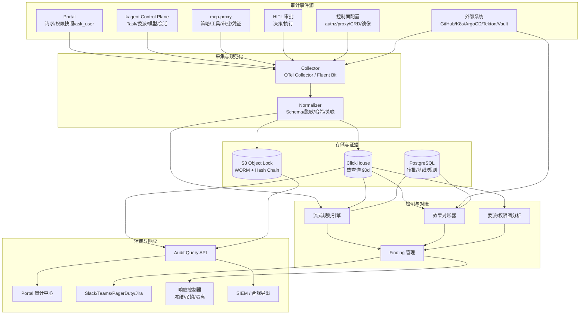
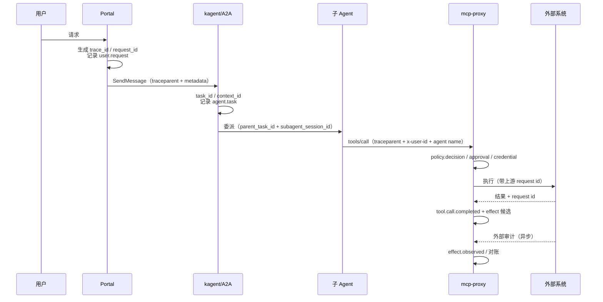

# 多 Agent 审计与越权检测方案

> 版本：v1.0
> 日期：2026-10-19
> 适用系统：AgentStage（kagent v1.0 + Portal + Router/共享子 Agent + MCP Proxy + GitHub/K8s/ArgoCD/Tekton 工具链）
> 定位：在现有「L1 软控（Prompt）+ L2 硬控（MCP Proxy 授权/审批）」之上，补齐 **L3 审计验证层**。
> 结论先行：**审计不是多打日志，而是把「用户意图 → 授权决策 → Agent 委派 → 工具调用 → 外部系统真实效果」串成一条可验证的证据链，并检测链上的任何断点。**

---

## 0. 执行摘要

### 0.1 为什么现有审计不够

当前 `mcp-proxy` 已经输出结构化 JSON 审计日志（`core/audit.py`），但它本质上是**单点自述**：

- 只能证明「proxy 认为自己执行了什么」，不能证明「GitHub / K8s 真的发生了什么」；
- 记录的是 `user_id / agent_name / tool / params / result`，缺少**委派链、授权快照、策略版本、凭证归属、外部请求 ID**；
- 日志只写 stdout，Pod 重启即丢，没有持久化、留存和防篡改；
- 审计发生在调用之后，无法在危险操作执行前拦截；
- 没有对账，无法发现「绕过 proxy 直接改 GitHub / kubectl」的影子操作。

### 0.2 方案核心：多面对账 + 一条证据链

```
意图面(Intent)       委派面(Agent)          决策面(Control)        效果面(Effect)
用户说了什么          Agent 想做什么/委派给谁   谁凭什么权限放行        外部系统真实变化
Portal 请求/快照  →  kagent 原生事件流   →  Proxy 策略/审批/凭证  →  GitHub/K8s/ArgoCD/Tekton
      │                  │                     │                      │
      └────────── 一条 trace_id / task_id / call_id ──────────────────┘
                                │
                        证据链完整性校验
                                │
             断点 = 越权 / 绕过 / 漂移 / 幻觉 / 越权委派
```

> **委派面（Agent 面）** 来自 kagent 原生事件流（`session_task_event` 里的 ADK `function_call` / `function_response` / `transfer_to_agent` / 模型输出），是 proxy 看不到的「Agent 意图与委派」的权威内部来源，用来与决策面/效果面交叉比对（详见 §6.3，已在本环境核验可用）。

典型断点：

| 断点 | 含义 | 例子 |
|---|---|---|
| 意图 ≠ 效果 | 用户只要读，实际发生写 | 用户问「看看失败 Pod」，Agent 直接删 Pod |
| 决策 ≠ 执行 | 策略拒绝/未审批，但执行成功 | bob 写 `devops-pipelines` 竟然成功 |
| 声明 ≠ 效果 | Agent 说成功，外部系统无变化 | 模型幻觉「已创建 Issue」 |
| 效果 ≠ 声明 | 外部系统有变化，proxy 无记录 | 有人用 SA token 直接 `kubectl delete` |
| 审批 ≠ 执行 | 批准的参数与实际执行参数不同 | 批准删 pod，执行删 namespace |
| 身份 ≠ 凭证 | 以 alice 身份操作，实际用 bob/服务账号 PAT | 匿名回退到 alice PAT |
| **Agent ≠ 决策** | Agent 调用了工具，但 proxy 无对应记录 | 子 Agent 绕过 proxy 直连 MCP server |
| **决策 ≠ Agent** | proxy 执行了工具，但 Agent 事件流无此调用 | 请求被注入/重放，伪造 `tools/call` |
| **委派 ≠ 权限** | 子 Agent 被委派了其角色之外的任务 | read Agent 被委派去执行 admin 工具 |

### 0.3 推荐落地节奏

| 阶段 | 周期 | 交付 | 目标 |
|---|---|---|---|
| **P0 可信审计底座** | 1–2 周 | 事件模型 v1、持久化、脱敏、哈希链、审批证据、8 条核心规则、门户审计页 | 能回答「谁、以什么身份、经谁批准、做了什么、外部是否真的发生」 |
| **P1 检测与对账** | 3–4 周 | 检测引擎、GitHub/K8s/ArgoCD/Tekton 对账、配置基线、告警 | 能发现绕过、影子操作、配置漂移、权限提升 |
| **P2 不可抵赖与响应** | 4–6 周 | WORM/签名/Merkle 锚定、自动冻结/吊销、SIEM/SOAR、合规报表 | 满足审计取证与合规要求 |

> 如果只能做一件事：**先做「效果面对账」**。因为授权层再严，也只能约束经过 proxy 的调用；只有对账能发现「没经过 proxy 的操作」。

---

## 1. 目标、范围与非目标

### 1.1 目标

| 编号 | 目标 | 验收口径 |
|---|---|---|
| G1 | 完整性 | 所有 L2+ 操作（写、审批、拒绝、提权）100% 有审计事件；审计不可用则拒绝执行 |
| G2 | 关联性 | 一次用户请求可还原完整链路：Portal → Router → 子 Agent → Proxy → 外部系统 |
| G3 | 可解释性 | 每个 allow/deny 都能回答「命中哪条策略、依据哪份授权、谁批准」 |
| G4 | 可验证性 | 审计记录防篡改；关键效果有独立外部证据，不依赖 Agent 自述 |
| G5 | 实时性 | 高危越权 MTTD < 1 分钟；对账类问题 < 15 分钟 |
| G6 | 可追责性 | 同时记录最终用户、执行 Agent、委派链、凭证归属、审批人 |
| G7 | 合规性 | 满足 NIST 800-53 AU-2/3/6/9/12、SOC 2 CC7、ISO 27001 A.8.15 的基本要求 |

### 1.2 范围

- 入口：Portal 的登录、聊天、ask_user、审批、会话。
- Agent：router-agent、github-*/k8s-* 子 Agent、A2A/共享子代理委派。
- 网关：mcp-proxy 的 tools/list、tools/call、策略决策、凭证选择、HITL、限流/熔断。
- 外部系统：GitHub、Kubernetes、ArgoCD、Tekton、Vault（以及未来 Jenkins/Jira/Grafana）。
- 控制面：`authorization.yaml`、`proxy.yaml`、Agent/RMCP/Harness CRD、模型配置、镜像 digest。

### 1.3 非目标

- 不做 LLM 内容安全网关（Prompt 注入过滤由 guardrail / agentgateway 负责）。
- 不替代 L1 软控和 L2 硬控；审计是第三道防线，不是唯一防线。
- 不做业务性能监控（APM）；只做安全审计与越权检测。
- 不在本期实现完整 SIEM 平台；只定义接入契约。

---

## 2. 威胁模型与「越权」定义

### 2.1 信任边界

| 层 | 可信度 | 说明 |
|---|---|---|
| 浏览器/用户输入 | 不可信 | 可能被篡改、Prompt 注入、重放 |
| Portal 进程 | 可信（但需加固） | 身份来自 OIDC session；当前会话存内存 |
| kagent 控制面/运行时 | 受信服务 | 但 Agent 行为受模型影响，不可信其「自述」 |
| mcp-proxy | 策略执行点 | 审计的第一现场，但不能只信它 |
| MCP 上游 Server | 受信但需校验 | 工具清单/描述可能被篡改（tool poisoning / rug pull） |
| GitHub/K8s/ArgoCD/Tekton | **效果真相源** | 审计的独立证据来源 |
| 审计存储 | 最高完整性 | 必须与被审计面隔离，Agent 不可删改 |

### 2.2 当前 POC 的关键信任假设（审计必须显式记录）

从代码现状看，以下假设会直接影响审计可信度，方案中必须记录并在 P1 前收敛：

1. `parse_context()` 对 `x-user-id == admin@kagent.dev` 直接放行，跳过 OIDC 校验（`core/context.py`）。
2. 匿名/服务上下文（`is_authenticated == false`）跳过资源级授权，且被注释为「可信服务身份，允许写」（`core/policy.py`）。
3. `proxy.yaml` 的 `defaultEnvVar: GITHUB_USER_PAT_ALICE` 会让未映射用户回退到 alice 的 PAT。
4. `X-Kagent-Agent-Name` 是 RMCP 静态注入的明文头，proxy 据此做 `allowedAgents` 判断。
5. `kagent-tools` 的 ServiceAccount 绑定了 `cluster-admin`（`12-kagent-tools-cluster-admin-rbac.yaml`），K8s 审计只能看到 SA，看不到真实用户。
6. 审批执行 `execute_approved_action()` 直接构造 `PolicyDecision(allow=True)`，不重新校验授权/参数/有效期（`server/handlers.py`）。

> 这 6 条不是「审计代码 bug」，而是**审计结论的前提**。前提不成立，审计记录只能证明「系统以为是这样」，不能证明「实际是这样」。

### 2.3 越权分类（Audit Taxonomy）

| 编号 | 类型 | 定义 | AgentStage 例子 |
|---|---|---|---|
| **A** | 水平越权 | 同角色访问了不属于自己的资源 | bob 写 `SDB-DevOps/devops-pipelines`（只授权 `AgentStage*`） |
| **B** | 垂直越权 | 低权限执行了高权限动作 | reader 调用 `k8s_delete_resource`；writer 调 `github_admin_create_repository` |
| **C** | 身份越权 | 以他人/服务身份执行 | 伪造 `x-user-id: alice`；匿名回退 alice PAT；`admin@kagent.dev` 直通 |
| **D** | 意图越权 | 权限内，但用户没要求/没同意 | 用户只让「检查」, Agent 顺手「清理」；创建额外 Issue/PR |
| **E** | 审批绕过 | 应审批未审批，或审批与执行不一致 | 参数被篡改；先执行后补审批；自批自审；审批重放 |
| **F** | 配置漂移 | 授权/策略/Agent 配置被非预期修改 | `authorization.yaml` 给 bob 加 write；HITL 改 `off`；新增 admin 工具 |
| **G** | 影子操作 | 外部系统有变更，但无对应 Agent 调用记录 | 直接 `kubectl delete`；用个人 PAT 直接 push；手工 ArgoCD sync |
| **H** | 行为异常 | 统计/序列/资源范围异常 | 深夜批量删资源；先全量列举再逐个删除；委派链异常加深 |
| **I** | 工具投毒 | 上游工具清单/描述/schema 被篡改 | MCP Server 新增未授权工具；工具描述诱导 Agent 读 secret |

### 2.4 审计必须回答的 7 个问题

1. **Who**：最终用户是谁？执行 Agent 是谁？委派链是什么？用的谁的身份/凭证？
2. **What**：哪个系统、哪个工具、什么动作、哪个资源、参数摘要是什么？
3. **When**：何时发起、何时决策、何时执行、何时生效？
4. **Why allowed**：命中哪条策略？依据哪份授权？谁批准的？
5. **On whose authority**：用户授权、角色授权、审批授权，还是服务身份？
6. **What changed**：外部系统真实变化是什么？能否独立验证？
7. **Was it expected**：与用户原始意图/计划是否一致？是否出现范围扩张？

---

## 3. 设计原则

1. **独立证据优先**：审计不能只信 Agent/Proxy 自述；关键写操作必须有外部系统证据。
2. **多面对账**：意图面、委派面、决策面、效果面分别采集，按 trace/task 关联，检测断点。
3. **双主体 + 委派链**：记录 `sub`（最终用户）+ `act`（执行 Agent 链），而不是一个 `user_id`。
4. **决策可解释**：每条 allow/deny 记录策略 ID、策略版本/哈希、命中规则、授权快照哈希。
5. **身份与凭证分离**：记录「声称身份」「验证身份」「凭证归属」三者；不一致就是发现。
6. **高危同步、低危异步**：L2+ 写操作同步写审计；审计不可用则拒绝（no audit, no write）。
7. **审计面隔离**：审计存储独立 namespace/账号；Agent 只有 append 权限，无读/删/改权限。
8. **确定性检测优先**：越权判定用规则/SQL/图算法；LLM 只做告警摘要与 triage，不做最终判定。
9. **默认全量、敏感脱敏**：安全事件不采样；敏感参数哈希/脱敏，文件内容只存摘要。
10. **配置即证据**：授权文件、策略文件、Agent CRD、模型配置都纳入版本基线与审计。

---

## 4. 总体架构



### 4.1 组件职责

| 组件 | 职责 | 关键要求 |
|---|---|---|
| Audit Emitter | 在 Portal/proxy/kagent adapter 中产生标准事件 | 同一 `trace_id`；写操作同步 emit |
| Collector | 接收 OTLP/JSON/Webhook，缓冲、批处理 | 至少一次投递；落盘 spool |
| Normalizer | 统一 schema、脱敏、哈希、字段补全 | 配置化字段白名单；不可逆哈希 |
| Hot Store | 查询、聚合、规则窗口 | ClickHouse 优先；POC 可用 PostgreSQL |
| Ledger | 不可篡改留存 | S3 Object Lock / WORM；哈希链 + 签名 |
| Stream Detector | 实时规则、序列/窗口检测 | 秒级；规则版本化 |
| Reconciler | 拉取外部审计，双向匹配 | 5–15 分钟；记录匹配置信度 |
| Graph Analyzer | 委派图、权限图、异常路径 |  nightly；检测环/越权路径 |
| Finding Store | 告警生命周期、证据包 | 去重、抑制、指派、闭环 |
| Response Controller | 冻结/吊销/只读/隔离 | 幂等；操作本身也审计 |

### 4.2 部署隔离

- 独立 namespace：`audit`（或 `security`），与 `kagent` 分离。
- 独立 ServiceAccount + RBAC：审计采集器只能写 Kafka/S3/ClickHouse 的 append 接口。
- NetworkPolicy：只允许 Portal/kagent/proxy/外部采集器访问；禁止 Agent Pod 访问审计查询 API。
- 审计存储凭据不挂载到 Agent/Proxy 的业务容器；Proxy 只持有「append token」。
- 审计系统自身的登录、查询、导出、删除（如保留策略）都要二次审计（meta-audit）。

### 4.3 模块划分：改动落在哪里

结论：**「事件产生」放在现有组件里做小改，「采集/存储/检测/查询」放到一个独立新模块做**。不要在 mcp-proxy 里长出整个审计平台。

| 模块 | 类型 | 是否新建 | 职责 | 边界 |
|---|---|---|---|---|
| `mcp_proxy` | 现有 | 小改 | 产生工具调用/策略/审批/凭证事件；脱敏；哈希；同步/异步投递 + 本地 spool | **不直连数据库**、不持有审计存储凭据、不做检测 |
| `portal` | 现有 | 小改 | 产生 `user.request` / `ask_user` / `auth.*`；透传 trace_id | 不采集外部系统 |
| `kagent` adapter | 新增（可选） | 新建 | 把 A2A task/委派/模型 span 转成审计事件 | 只读；不阻塞 agent |
| `audit_service` | **新模块（独立进程/镜像）** | 新建 | Ingest API、Normalizer、Store、Ledger、Detector、Reconciler、Findings、Query API | 审计面；不依赖 AgentStage API 才能收事件 |
| `agentstage_api` | **新模块（控制面）** | 新建（你们已设计） | 用户/角色/权限/审批人/凭证注册表/挂起名单/授权包 | 控制面；不存审计事件、不做检测 |
| 外部 connectors | `audit_service` 子模块 | 新建 | GitHub/K8s/ArgoCD/Tekton/Vault 拉取 | 只读凭证，独立 SA |
| 审计前端 | Portal 或 AgentStage API 前端 | 小改/新建 | 用户/审批人/安全三视图 | 只调 Query API |

**为什么必须分成独立模块（而不是全塞 proxy）**：

1. **可用性解耦**：proxy 是写路径上的关键组件，审计平台升级/重启不应影响 proxy 的读写；反之审计服务宕机时 proxy 通过 spool + fail-closed 降级，而不是感知整个平台。
2. **凭据边界**：审计存储的读/删权限绝不能在 proxy 容器里；proxy 只拿一个 append-only 的 ingest token。
3. **可独立演进**：检测规则、对账 connector、ClickHouse schema 迭代频率远高于 proxy；独立部署、独立镜像、独立 HPA。
4. **可独立审计**：审计面自身要能被 meta-audit，和被审计面同进程会失去独立性。
5. **多写入源**：Portal、kagent、K8s audit、外部系统都要写入，天然需要一个公共 Ingest 层。

**建议目录（同仓库多模块，独立部署；未来可拆仓库）**：

```text
AgentStage/
  mcp_proxy/
    src/mcp_proxy/audit/          # 新增：emitter / schema / redact / sink_client / spool
  portal/
    src/portal/audit.py           # 新增：轻量 emitter
  audit_service/                  # 新模块
    src/audit_service/
      api/          # POST /v1/events, GET /v1/events, /v1/traces, /v1/findings
      ingest/       # 校验 / event_id 去重 / 哈希链 / spool 接收
      normalize/    # schema 补全 / 脱敏 / resource 解析 / 关联
      store/        # postgres|clickhouse 写入 / ledger(WORM) / 查询
      detect/       # 流式规则 / 窗口聚合 / 图分析
      reconcile/    # github / k8s / argocd / tekton / vault connectors
      findings/     # 告警、证据包、响应回调
    rules/          # 规则即代码（yaml/py + 测试）
    config/
    deploy/
  agentstage_api/                 # 新模块（控制面，你们已设计）
```

> POC 阶段可以先把 `audit_service` 做成一个 FastAPI 进程 + PostgreSQL，跑在 `audit` namespace；事件量上来再换 ClickHouse，接口不变。

---

## 5. 审计事件模型

### 5.1 事件类型

| event_type | 产生点 | 关键内容 |
|---|---|---|
| `user.request` | Portal | 原始请求、Prompt 哈希、权限快照、Service Catalog、session |
| `auth.login/logout` | Portal/mock-oidc | 用户、方式、IP、UA、结果 |
| `agent.task.start/end` | kagent adapter | task_id、context_id、agent、模型、状态 |
| `agent.tool.call/result` | kagent adapter | `function_call`/`function_response`：工具名、call_id、参数摘要、结果摘要 |
| `agent.delegation` | kagent adapter | parent_task → child_task、子 Agent（`transfer_to_agent`）、委派深度 |
| `agent.session.deleted` | kagent adapter | session/task 删除、deletion_reason、删除人 |
| `tool.discovery` | mcp-proxy | tools/list 可见工具集、上游工具清单哈希 |
| `tool.call` | mcp-proxy | 工具、参数摘要、资源、结果、上游 request id |
| `policy.decision` | mcp-proxy | allow/deny/hitl、策略版本、命中规则、授权快照 |
| `approval.created/decided/executed/expired` | proxy/审批服务 | 审批人、参数摘要、签名、执行结果 |
| `credential.issued/selected` | proxy/Vault | 凭证类型、归属主体、TTL、指纹（非明文） |
| `effect.observed` | 对账器 | 外部系统事件、资源、变更前后摘要、匹配结果 |
| `config.changed` | GitOps/K8s watch | 文件/CRD、旧/新哈希、变更人 |
| `anomaly.finding` | 检测引擎 | rule_id、severity、证据事件、建议动作 |
| `audit.health` | 采集器 | 队列深度、丢弃数、延迟、链校验结果 |

### 5.2 核心字段（必填 vs 选填）

#### A. 身份与授权（Identity）

| 字段 | 必填 | 说明 |
|---|---|---|
| `subject.user_id` | ✅ | 最终用户（OIDC `preferred_username`/`sub`，**已验证**） |
| `subject.groups` | ✅ | IdP groups / 角色 |
| `subject.auth_method` | ✅ | oidc / header-passthrough / service-token |
| `actor.agent_id` | ✅ | 直接执行 Agent（如 `github-ops-agent`） |
| `actor.agent_version` | ⬜ | AgentTemplate/镜像 digest |
| `actor.act_chain` | ✅ | 委派链：`["router-agent","github-ops-agent"]` |
| `actor.delegation_depth` | ✅ | 跳数；用于检测异常委派 |
| `credential.owner` | ✅ | 凭证实际归属：`alice` / `github-app` / `kagent-tools-sa` |
| `credential.type` | ✅ | user_pat / github_app / service_account / impersonation |
| `credential.fingerprint` | ✅ | token 前缀哈希，**不记录明文** |
| `tenant.team/namespace/env` | ⬜ | 多租户标签 |

> **关键**：`subject.user_id`、`actor.agent_id`、`credential.owner` 三者不一致时，必须产生 `identity.mismatch` 发现（除非有显式服务身份豁免，且豁免本身被审计）。

#### B. 关联与血缘（Correlation）

| 字段 | 必填 | 说明 |
|---|---|---|
| `trace_id` | ✅ | W3C Trace Context；Portal 生成，全链路透传 |
| `span_id` / `parent_span_id` | ⬜ | OTel |
| `request_id` | ✅ | 单次工具调用/请求幂等 ID |
| `session_id` | ✅ | Portal 会话 ID |
| `context_id` | ✅ | A2A contextId（会话） |
| `task_id` | ✅ | A2A taskId（单次任务） |
| `parent_task_id` | ⬜ | 委派父任务 |
| `root_task_id` | ✅ | 根任务；用于聚合 |
| `correlation_confidence` | ⬜ | exact / strong / weak（对账匹配用） |

#### C. 动作与资源（Action/Resource）

| 字段 | 必填 | 说明 |
|---|---|---|
| `system` | ✅ | github / k8s / argocd / tekton / vault |
| `tool` | ✅ | 如 `github_delete_file`、`k8s_delete_resource` |
| `verb` | ✅ | read / write / delete / merge / exec / admin |
| `resource.type` | ✅ | repo / issue / pr / file / namespace / deployment / pod |
| `resource.id` | ✅ | 具体资源标识 |
| `resource.scope` | ✅ | owner/repo/namespace/cluster/env |
| `params.digest` | ✅ | 规范化 JSON 的 SHA-256（RFC 8785 JCS） |
| `params.redacted` | ✅ | 脱敏后的参数；文件内容只留 `sha256+size+path` |
| `risk.level` | ✅ | L0–L4（见 §9.1） |

#### D. 决策与审批（Decision/Approval）

| 字段 | 必填 | 说明 |
|---|---|---|
| `decision.effect` | ✅ | allow / deny / hitl / error |
| `decision.policy_id` | ✅ | 策略集标识 |
| `decision.policy_version` | ✅ | `authorization.yaml` 的 git commit / 文件哈希 |
| `decision.policy_hash` | ✅ | 策略内容哈希 |
| `decision.rule_id` | ✅ | 命中规则（如 `AUTHZ_DENIED`、`PARAM_VIOLATION`） |
| `decision.reason` | ✅ | 人类可读原因 |
| `decision.authz_snapshot_hash` | ✅ | 注入 Prompt 的权限快照哈希 |
| `approval.id` | ⬜ | 审批单号 |
| `approval.status` | ⬜ | PENDING/APPROVED/REJECTED/EXPIRED |
| `approval.approver` | ⬜ | 审批人（已验证身份） |
| `approval.approver_role` | ⬜ | 审批人角色 |
| `approval.params_digest` | ⬜ | **批准时的参数摘要**；执行时必须比对 |
| `approval.decided_at` / `expires_at` | ⬜ | 时间边界 |
| `approval.signature` | ⬜ | 审批决策签名 |

#### E. 结果与效果（Result/Effect）

| 字段 | 必填 | 说明 |
|---|---|---|
| `result.status` | ✅ | success / error / denied / pending / partial |
| `result.error_code` | ⬜ | 上游/策略错误码 |
| `result.upstream_request_id` | ✅ | GitHub `X-GitHub-Request-Id` / K8s `auditID` / ArgoCD revision / Tekton UID |
| `result.digest` | ⬜ | 响应体摘要（避免存全量） |
| `result.latency_ms` | ✅ | 时延 |
| `effect.observed_by` | ⬜ | github-audit / k8s-audit / argocd / tekton / api-snapshot |
| `effect.change_digest` | ⬜ | 变更前后摘要 |
| `effect.match_status` | ⬜ | matched / shadow / phantom / ambiguous |

#### F. 完整性（Integrity）

| 字段 | 必填 | 说明 |
|---|---|---|
| `event_id` | ✅ | ULID（单调、可排序） |
| `event_time` | ✅ | 事件发生时间（UTC） |
| `ingest_time` | ✅ | 采集时间（UTC） |
| `schema_version` | ✅ | `1.0` |
| `prev_hash` | ✅ | 上一条事件哈希（分片/分区内链） |
| `event_hash` | ✅ | `SHA256(JCS(event_without_hash) || prev_hash)` |
| `signer` / `signature` | ⬜ | 批量签名（Ed25519/KMS） |

### 5.3 示例：一次被拒绝的越权写

```json
{
  "schema_version": "1.0",
  "event_id": "01JABCDEF1234567890ABCDEFG",
  "event_type": "tool.call",
  "event_time": "2026-10-19T08:12:33.421Z",
  "ingest_time": "2026-10-19T08:12:33.480Z",
  "trace_id": "4bf92f3577b34da6a3ce929d0e0e4736",
  "span_id": "00f067aa0ba902b7",
  "session_id": "alice-7f3a1c2d",
  "context_id": "ctx-9b2e",
  "task_id": "task-1f0c",
  "root_task_id": "task-1f0c",
  "parent_task_id": null,
  "delegation_chain": ["router-agent", "github-ops-agent"],
  "delegation_depth": 1,
  "subject": {"user_id": "bob", "groups": ["dev"], "auth_method": "oidc"},
  "actor": {"agent_id": "github-ops-agent", "agent_version": "sha256:..."},
  "credential": {"owner": "bob", "type": "user_pat", "fingerprint": "sha256:ab12..."},
  "system": "github",
  "tool": "github_delete_file",
  "verb": "delete",
  "resource": {
    "type": "file",
    "id": "SDB-DevOps/devops-pipelines/config/prod.yaml",
    "scope": {"owner": "SDB-DevOps", "repo": "devops-pipelines", "path": "config/prod.yaml"}
  },
  "params": {
    "digest": "sha256:9f2c...",
    "redacted": {"owner": "SDB-DevOps", "repo": "devops-pipelines", "path": "config/prod.yaml", "message": "cleanup"}
  },
  "risk": {"level": "L3"},
  "decision": {
    "effect": "deny",
    "policy_id": "authz-v1",
    "policy_version": "git:4c1d2a7",
    "policy_hash": "sha256:77ab...",
    "rule_id": "AUTHZ_DENIED",
    "reason": "user 'bob' cannot write on 'github' scope={'owner': 'SDB-DevOps', 'repo': 'devops-pipelines'}",
    "authz_snapshot_hash": "sha256:1e90..."
  },
  "approval": null,
  "result": {
    "status": "denied",
    "error_code": "AUTHZ_DENIED",
    "upstream_request_id": null,
    "latency_ms": 3
  },
  "integrity": {
    "prev_hash": "sha256:...",
    "event_hash": "sha256:..."
  }
}
```

### 5.4 示例：一次审批通过的 merge（含审批绑定）

```json
{
  "event_type": "tool.call",
  "tool": "github_merge_pull_request",
  "verb": "merge",
  "resource": {"type": "pull_request", "id": "SDB-DevOps/AgentStage#42"},
  "params": {"digest": "sha256:aaa111", "redacted": {"owner": "SDB-DevOps", "repo": "AgentStage", "pull_number": 42}},
  "decision": {"effect": "allow", "rule_id": "APPROVED", "policy_version": "git:4c1d2a7"},
  "approval": {
    "id": "ap-b41c56ebd1ba",
    "status": "APPROVED",
    "approver": "alice",
    "approver_role": "approver",
    "params_digest": "sha256:aaa111",
    "decided_at": "2026-10-19T08:15:02Z",
    "expires_at": "2026-10-20T08:12:00Z",
    "signature": "ed25519:..."
  },
  "result": {"status": "success", "upstream_request_id": "GH-REQ-9f2c", "latency_ms": 421}
}
```

### 5.5 ID 与摘要规则

- `event_id`：ULID，保证全局唯一且按时间可排序。
- `trace_id`：W3C `traceparent`；无则 Portal 生成 16 字节十六进制。
- `params.digest`：对参数做 RFC 8785 JCS 规范化后 SHA-256；数组顺序、数字格式必须稳定。
- `result.digest`：响应体 SHA-256；大响应只存摘要 + 大小 + 内容类型。
- `event_hash`：`SHA256(JCS(event 去掉 integrity) + prev_hash)`；按 `tenant + date` 分区链。
- **禁止**把 token、password、private key、kubeconfig、完整文件内容写入审计。

### 5.6 脱敏策略

| 数据类型 | 策略 |
|---|---|
| GitHub PAT / App JWT / OIDC token | 不记录；只记录类型 + 指纹 + 归属 |
| 文件内容（`create_or_update_file`、`push_files`） | 只记录 `path`、`sha256`、`size`、`content_type` |
| Issue/PR 正文 | 默认记录长度 + 摘要；需要取证时加密存全文 |
| K8s Secret / ConfigMap 值 | 只记录资源名 + 值哈希；不记录 data |
| 用户 Prompt | 默认记录哈希 + 长度；取证模式加密存全文 |
| IP/UA | 记录；按合规要求可截断 |
| 正则兜底 | `gh[pousr]_`、`github_pat_`、`AKIA...`、`-----BEGIN ... PRIVATE KEY-----`、`eyJ...`（JWT） |

---

## 6. 全链路埋点

### 6.1 埋点总表

| 组件 | 事件 | 关键字段 | 现状 | 缺口 |
|---|---|---|---|---|
| Portal `/api/chat` | `user.request` | prompt_hash、permission_snapshot、trace_id、session | 无 | 新增 |
| Portal ask_user/resume | `user.decision` | question、answer、request_id、task_id | 无 | 新增 |
| Portal 登录/登出 | `auth.*` | user、method、IP、UA | 无 | 新增 |
| kagent A2A | `agent.task.*` | task_id、context_id、agent、model、actor_uid | Postgres `session`/`session_task` | 只读采集 + 解析（§6.3） |
| kagent 子代理 | `agent.delegation` | parent/child task、子 Agent | Postgres `session_task_event`（`transfer_to_agent`） | 解析 `args.agent_name` |
| kagent LLM / 工具 | `agent.tool.call/result`、`model.call` | 工具名、call_id、参数摘要、tool_calls、tokens | Postgres `session_task_event` | 解析 A2A 事件 + 脱敏 |
| mcp-proxy `tools/list` | `tool.discovery` | agent、可见工具集、上游清单哈希 | 只有 count | 需补全 |
| mcp-proxy `tools/call` | `tool.call` | 全字段 | 有基础版 | 需扩展 |
| mcp-proxy 策略 | `policy.decision` | 规则、版本、快照 | 混在结果里 | 拆独立事件 |
| mcp-proxy 审批 | `approval.*` | 审批人、参数摘要、执行 | 有基础版 | 需签名/重校验 |
| mcp-proxy 凭证 | `credential.selected` | 类型、归属、指纹 | 无 | 新增 |
| mcp-proxy 上游结果 | `result` | upstream_request_id | 无 | 新增 |
| 外部系统 | `effect.observed` | GitHub/K8s/ArgoCD/Tekton | 无 | 新增对账 |
| 控制面 | `config.changed` | authz/proxy/CRD/镜像 | 无 | 新增基线 |

### 6.2 Portal 埋点

在 `portal/src/portal/main.py` 的 `/api/chat`、`/api/chat/resume`、`/callback` 中增加：

1. 生成 `trace_id`（若请求未带），写入 `traceparent`。
2. 记录 `user.request`：
   - `subject`（来自 OIDC session，不信任前端）
   - `prompt_hash` + 长度
   - `permission_snapshot`（`_build_prompt_context` 生成的权限边界文本的哈希 + 结构化的 authz 摘要）
   - `service_catalog` 版本/哈希
   - `session_id` / `a2a_sid`
   - `model` / `agent`（router）
3. ask_user/resume 记录 `question_id`、`answer`（脱敏）、`task_id`、`request_id`。
4. 登录成功/失败、角色变更、管理员操作记录 `auth.*`。
5. 不要把 Cookie、id_token 写入审计。

> 目的：当出现「Agent 做了用户没要求的事」时，能证明用户当时到底说了什么、Agent 被注入了什么权限。

### 6.3 kagent 原生事件流（Agent 面 / 委派面）—— 已核验可用

**结论：kagent v1.0 已经把「每次 agent ↔ tool / agent ↔ agent 交互」持久化在它自己的 PostgreSQL 里，可以直接作为审计的「Agent 面」数据源，不需要改 kagent。**

已在开发环境核验：`kagent-controller` 镜像 `ghcr.io/kagent-dev/kagent/controller:1.0.0-alpha9`，namespace `kagent`，DB 为 `kagent-postgresql`（库/用户均为 `kagent`）。

#### 6.3.1 数据在哪

| 表 | 用途 | 关键列 |
|---|---|---|
| `session` | 会话（≈ A2A context） | `id`、**`actor_uid`（发起用户身份）**、`context_id`、`history_id` |
| `session_task` | 一次任务 | `id`、`state`、`history_id`、`position`、`snapshot_*` |
| `session_task_event` | **事件流（核心）** | `task_id`、`sequence`、`message_id`、`created_at`、`mutation_hash`、`published`、`data`(bytea/protobuf) |
| `a2a_context` | context ↔ session 映射 | `context_id`、`id` |
| `runtime_instance` | 运行时实例 | `user_id`、`request_id`、`operation`、`prepared_revision` |
| `tool` / `toolserver` | 工具目录 | `server_name`、`id`、`description`、`group_kind` |
| `agent_definition` / `agent_revision` | Agent 定义与版本 | `agent_name`、`agent_uid`、`desired_revision`、`agent_card` |

本次核验规模：145 session / 181 task / **2546 event** / 572 tool / 20 toolserver；其中 `function_call` 236、`function_response` 236、含 token usage 1844。

#### 6.3.2 事件流里有什么

`session_task_event.data` 是 protobuf（A2A/ADK 事件，`kagent.dev/a2a/*` metadata）。实测可解出：

- `part-type=function_call` → 工具调用：`name`（工具名，如 `transfer_to_agent`、`cluster-info`、`analyze`）、`id`（`call_xxx`）、`args`（参数，如 `{"agent_name":"k8s-read"}`）；
- `function_response` → 工具结果；
- **`transfer_to_agent` → 委派链**（子 Agent 名在 `args.agent_name`）；
- 模型输出文本、`thought` 签名（不透明 blob，不解）；
- `kagent.dev/a2a/usage`（`promptTokenCount`/`candidatesTokenCount`/`totalTokenCount`）；
- `kagent.dev/a2a/timeline-position`（事件时间）；
- 表级：`message_id`、`sequence`、`mutation_hash`（原生变更哈希，可作完整性辅助校验）。

#### 6.3.3 怎么采：API 优先，DB 只作受控兜底

先纠正一个前提 —— kagent 的 API 分三类，**只有前两类适合外部审计**（已核验源码 `proto/kagent/runtime/v1/task_store.proto`）：

| API | 能拿到 | 鉴权 | 适用 |
|---|---|---|---|
| `kagent.api.v1alpha1.SessionService` / `AgentService` / `ToolService` | 会话（`creator`、`agent`、`contextId`、`preparedRevision`、`state`、分页 `nextPageToken`）、Agent/工具目录 | 现状无鉴权（`AUTH_MODE=insecure`） | ✅ 会话级元数据 |
| `lf.a2a.v1.A2AService`：`ListTasks` / `GetTask` / `SubscribeToTask`（同时有 REST `GET /tasks`、`GET /tasks/{id}`） | A2A `Task`，含 `history`（即 `function_call`/`function_response` 事件流） | 按 session/tenant 授权 | ✅ 事件流（按 task 取） |
| `kagent.runtime.v1.TaskStoreService`（`GetTask`/`ListTasks`/`UpdateTask`…） | 同样的 task/history | **源码注释：private API，every call requires workload authority；public user/share 凭证无权访问** | ❌ 运行时私有 API，不是给外部用的 |

所以「走 API」是可行的：**`SessionService` 列会话 + A2A `GetTask/ListTasks` 取每个 task 的 history**，不需要碰 DB。

但要正视两个现实障碍：

1. **权限**：A2A `GetTask` 按会话归属/租户授权，`TaskStoreService` 更只认 workload。审计服务需要**专用 auditor 身份**（workload/服务账号）才能跨会话读取，而不是复用某个用户凭证；该特权本身要受控并 meta-audit。
2. **契约稳定性**：controller 反射未返回 `a2a.proto`（`describe TaskStoreService` 直接失败），且当前 `AUTH_MODE=insecure`。现在「能读」是配置漏洞的结果，**不能当成稳定的集成方式**。

因此推荐：

| 优先级 | 方案 | 说明 |
|---|---|---|
| **P0 首选** | **官方 API** | `audit_service` 用专用只读身份调 `SessionService.ListSessions` + A2A `ListTasks/GetTask`，解析 `history` 得到 `function_call/response`、`transfer_to_agent`。 |
| 兜底 | **只读副本 / 逻辑复制** | 仅当 API 拿不到必需字段（`session.actor_uid`、`mutation_hash`、`sequence`）时启用：把 kagent 库复制到审计侧副本，用最小权限只读账号 + 只读事务 + `statement_timeout`。 |
| 长期 | **kagent 侧只读审计导出** | 让 kagent 提供全量 export（或 OTel 全量），审计侧只收，零耦合。 |
| 禁止 | 直连 kagent 主库 | 不给审计服务主库的通用/owner 账号，不做批量扫描主库。 |

**为什么反对「直接读主库」**（回应「风险比较高」的顾虑）：

- **schema 耦合**：`data` 是内部 protobuf，无对外契约，alpha 版本间会变；DB 不是 API，升级即可能崩。
- **爆炸半径**：审计服务被攻破 = kagent 全部会话/事件可读，而它本不该有这份权限。`TaskStoreService` 的注释恰恰证明 kagent 自己认为这类数据敏感、需授权。
- **负载与隔离**：批量扫描会打在主库上。
- **绕过访问控制**：等于旁路 kagent 自身的授权模型，审计系统反而成了最大的越权面。

无论走哪条路，采集侧都要**独立落快照**（kagent `session` 可被删除）。

> 待确认：API 的 `creator`（dev 里是 `admin@kagent.dev`）与 DB 的 `session.actor_uid`（UUID）语义是否一致。若最终用户身份只在 DB 而不在 API，则是「用 API 会丢用户身份」的硬约束，需要 kagent 补字段或走副本，而不是直连主库。

#### 6.3.3.1 能不能让 kagent 主动推给我们？—— 能，但都不是「每次工具调用」

kagent 内置了 A2A push notification（`push_http_sender.go`/`push_jwt.go`，UI 有「Task Push Notifications」弹窗，架构文档 `docs/architecture/a2a-push-notifications.md`）。加上 OTel export，共有三种「推送」通道：

| 机制 | 推送什么 | 实时性 | 覆盖度 | 结论 |
|---|---|---|---|---|
| **A2A push notification（内置 webhook）** | **任务状态变更**：`INPUT_REQUIRED`/`AUTH_REQUIRED`/`COMPLETED`/`FAILED`/`CANCELED`/`REJECTED` | 秒级 | **不推普通进度 → 不含每次 `function_call`**；收到通知后需再 `GetTask` 取 `history` | ⚠️ **本环境不可用**（见下）；且不是事件流 |
| **OTel export** | model/tool span（`gen_ai.*`；开 `captureContent` 时含 `tool.call.arguments`/`tool.call.result`） | 实时 | 受采样与内容开关影响，非账本级 | ✅ 唯一真正"全局 push"，但属观测级 |
| **`SubscribeToTask`（server streaming）** | 单个 task 的流式更新 | 实时 | 仅未终态 task、按 task 订阅 | ✅ 本环境 `streaming: true` 可用 |
| 增量轮询 `ListTasks(status_timestamp_after=…)` | 状态在游标之后变化的 task | 轮询间隔 | 全量可控 | ✅ P0 足够 |
| Postgres CDC（逻辑复制） | 每一行变更 | 实时 | 全量 | DB 耦合 + 需特权，不建议 |

必须知道的事实：

- **A2A 通知在本环境不可用**：`GetExtendedAgentCard` 实测 `capabilities.pushNotifications = false`（`streaming = true`），调用 `CreateTaskPushNotificationConfig` 直接返回 `PUSH_NOTIFICATION_NOT_SUPPORTED`。kagent 核心代码里虽有整套 push notification（DB 表 + sender + JWT），但你们的 A2A 端点（经 Substrate/ATE 网关）没打开这个能力。**所以在当前环境，push 通知这条路走不通**。
- A2A 通知是**按 task 注册**的（`TaskPushNotificationConfig`，或 `SendMessage` 时内嵌 `configuration.taskPushNotificationConfig`），**不能订阅「全平台所有事件」**。所以即便将来打开，也仍需先发现活跃 task。
- 通知 payload 只有 `{"statusUpdate":{"taskId","contextId","status"}}`；要拿 `function_call`/`function_response` **必须再调 `GetTask` 读 `Task.history`** → 本质是「**push 通知、pull 补齐**」。
- 通知语义：at-least-once，最多 10 次重试、可重复/乱序、合并 pending 状态；**以 `GetTask` 为准**。
- 未来若打开：默认要求 HTTPS + 公网目标；集群内需 `config.push.allowHttp` + `config.push.allowPrivateNetworks`。可配 Ed25519 签名，每次请求带 5 分钟 JWT，公钥在 `/.well-known/jwks.json` → 审计侧可解 `kid`/验签，天然适合做回调真实性校验。
- **轮询其实不贵**：`ListTasks` 支持 `status_timestamp_after` 增量过滤（不是全量扫描），配 `history_length`。

**结论：不要为了实时性硬上 push。**

1. 真正「不能漏、且要求实时」的是**写操作**，它已经走 mcp-proxy 的**同步审计（L2）** —— 那是我们自己控制的 push 通道。kagent 事件流用于**对账/交叉验证**（R25–R27），几十秒延迟无妨。
2. **P0**：`ListSessions` + `ListTasks(status_timestamp_after=cursor)` 增量轮询 + `GetTask` 取 `history`。简单、稳、够用。
3. **P1（若 kagent 打开 push）**：对活跃 task 注册 A2A push notification，webhook 收到终态/中断态后立刻 `GetTask` 拉 history，Ed25519 JWT 验签 → 秒级对账。当前环境需先让 kagent/ATE 支持。
4. **可选实时观测（现在就能做）**：kagent `config.runtimeDefaults.telemetry.traces.endpoint` → OTel Collector（kagent 自带参考 collector 配置），span 含 tool 参数/结果；这是当前环境下唯一的实时"推"通道，但作观测与辅助证据，不作账本。
5. 也可对个别关键 task 用 `SubscribeToTask` 流式订阅（`streaming: true`），但不适合做全量审计采集。

#### 6.3.4 字段抽取与用途

抽取并对齐到审计事件：

- `task_id`、`context_id`、`parent_task_id`（由 `transfer_to_agent` 还原）
- `agent_id`、`agent_template`、模型/版本（`agent_revision`、`runtime_instance`）
- 委派目标子 Agent（`transfer_to_agent.args.agent_name`）
- 工具调用：`name` + `args` 摘要 + `call_id`
- 发起用户：`session.actor_uid`（与 proxy 的 `verified_user` 对账）
- token usage（异常/成本）

由此新增的检测能力（对应 §9.2 的 R25–R28）：

- **Agent 调用了，proxy 没有** → 子 Agent 绕过 proxy 直连 MCP server；
- **proxy 执行了，Agent 没有** → 请求注入/重放/伪造；
- **Agent 声称 vs 实际效果** → 幻觉（R18）有了权威依据；
- **委派链越权** → read 子 Agent 被委派写工具、深度/环异常（R12/R19/R27）。

> 注意：kagent 事件流仍是 **kagent 自报**（与 proxy 同属受信服务域），属「Agent 面」而非「效果面」。它能与 proxy 交叉验证，但**不能替代** GitHub/K8s 等外部对账。

### 6.4 mcp-proxy 埋点

在 `server/handlers.py` 的 `call_tool` 中拆成至少 5 个事件，共享同一 `request_id` / `trace_id`：

```
1. tool.call.received     ← 收到 tools/call（参数摘要）
2. policy.decision       ← allow/deny/hitl + 规则 + 策略版本
3. approval.created      ← 如需 HITL
4. credential.selected   ← 实际使用的凭证归属/类型/指纹
5. tool.call.completed   ← 上游结果 + upstream_request_id + 时延
```

拒绝路径也必须产生 `policy.decision` + `tool.call.completed(status=denied)`，且 `verb` 保留真实意图（不要写成 `action="deny"`）。

`tools/list` 记录：

- 调用方 agent、user
- 返回的工具名集合的哈希
- 上游工具清单的哈希（用于检测 tool inventory drift）
- 被裁剪掉的工具数量/原因（可选）

### 6.5 HITL 埋点

- `approval.created`：审批单号、工具、参数摘要、资源、风险等级、发起人、委派链、过期时间。
- `approval.decided`：审批人（**独立验证**）、角色、决策、理由、签名、决策时间。
- `approval.executed`：执行时重新校验的结果、实际参数摘要、上游 request id、结果。
- `approval.expired/cancelled`：原因、是否被重试。

审批详情必须能回答：

- 审批人是否等于发起人？（四眼原则）
- 审批人是否有审批权限？
- 批准的参数摘要与执行参数摘要是否一致？
- 审批是否在有效期内？
- 审批后用户权限是否被撤销？
- 审批是否被重复使用？

### 6.6 外部系统采集

| 系统 | 采集方式 | 关键字段 | 注意事项 |
|---|---|---|---|
| GitHub | Org Audit Log API / Audit Log Streaming / Webhook / API 状态快照 | actor、action、repo、created_at、request_id、token 指纹 | 个人仓库/PAT 操作可能不在 org audit log；需用 App/Org 策略兜底 |
| Kubernetes | API Server audit policy + audit log | `auditID`、`user.username`、`impersonatedUser`、verb、resource、responseStatus | 当前 `kagent-tools` 是 cluster-admin，审计只看到 SA；建议做 impersonation |
| ArgoCD | API audit log / notifications / app history | app、revision、sync、actor、time | 手工 sync 必须能被识别 |
| Tekton | K8s audit + PipelineRun/TaskRun 状态 + labels/annotations | UID、name、namespace、trigger、actor | 记录触发来源（webhook/manual） |
| Vault | Audit devices | token access、path、actor、time | 关联凭证签发 |

### 6.7 控制面埋点

以下变更必须产生 `config.changed`，并与 GitOps 仓库的 commit 对账：

- `authorization.yaml`（授权）
- `proxy.yaml`（工具白名单、参数策略、HITL 模式、凭证配置）
- AgentTemplate / Agent / RemoteMCPServer / Harness CRD
- 模型配置（模型名、baseURL、版本）
- 镜像 digest（尤其 Harness 运行时、proxy、MCP server）
- 审批人名单/角色
- 审计策略/保留策略

记录：变更前后哈希、变更人（K8s user/SA）、Git commit、是否经 PR 审核、生效时间。

### 6.8 采集实现（Ingest / Collector / Normalizer / External Pullers）

上一版只画了「源 → Collector → Store」的箭头，这里给出**具体怎么采集**。

#### 6.8.1 采集模式矩阵

| 源 | 模式 | 通道 | 频率 | 可靠性 |
|---|---|---|---|---|
| `mcp_proxy` | push | `POST /v1/events`（NDJSON 批量） | 实时（L2+ 同步；L0/L1 异步） | 本地加密 spool + 重试 |
| `portal` | push | `POST /v1/events` | 实时（异步） | 内存队列 + 重试 |
| `kagent` | pull（增量）/ 可选 push | `ListSessions` + `ListTasks(status_timestamp_after)` + `GetTask`；A2A push notification 作触发器 | 30–60s / 秒级 | checkpoint + 快照（§6.3.3.1） |
| K8s API Server | push | audit webhook / filelog | 实时 | Collector file_storage |
| GitHub | pull | Audit Log API / Streaming / Webhook / 状态快照 | 5 min / 实时 | checkpoint |
| ArgoCD | pull | API 审计 / app history | 5 min | checkpoint |
| Tekton | pull | K8s API 查询 PipelineRun/TaskRun | 5 min | checkpoint |
| Vault | pull | audit device（file/syslog）→ Collector | 实时 | file_storage |

两类通道：

- **Push（业务组件）**：组件内嵌 SDK，产生事件后直接投递到 `audit_service` 的 Ingest API；优点是低延迟、字段全；缺点是给业务增加一次网络调用（所以只在高危操作上同步）。
- **Pull（外部系统）**：`audit_service` 的 connector 周期性拉取；优点是业务零侵入、是独立证据；缺点是有延迟、受外部 API 限制。对账本质上就是 pull 通道。

#### 6.8.2 mcp-proxy 侧：Audit Emitter（只加这一层）

新增 `mcp_proxy/src/mcp_proxy/audit/`，不动现有策略逻辑：

```text
mcp_proxy/src/mcp_proxy/audit/
  __init__.py
  schema.py        # AuditEvent dataclass / pydantic，字段见 §5.2
  redact.py        # 按 tool 的字段白名单 + 正则兜底脱敏
  digest.py        # JCS 规范化 + sha256；event_hash 计算
  chain.py         # per-shard prev_hash 维护（启动时从 sink 拉最后一条）
  sink_client.py   # HTTP 客户端：POST /v1/events，超时/重试
  spool.py         # 本地加密文件 spool（sink 不可用时）
  emitter.py       # AuditEmitter.emit(event, sync: bool)
```

`handlers.py` 的改造点（伪代码）：

```python
# call_tool 主流程
audit.emit(event("tool.call.received", ...), sync=False)

decision = policy.check_tool(...)
audit.emit(event("policy.decision", effect=..., rule_id=..., policy_version=...), sync=True)

if decision.action == "hitl":
    audit.emit(event("approval.created", ...), sync=True)
    ...
# 执行前
audit.emit(event("credential.selected", owner=..., type=..., fingerprint=...), sync=True)
result = await invoke_upstream(...)
audit.emit(event("tool.call.completed", status=..., upstream_request_id=..., latency_ms=...), sync=True)
```

`AuditEmitter.emit` 的行为：

```text
emit(event, sync):
  event.event_id  = ulid()          # 源端生成，天然幂等
  event.event_hash = sha256(JCS(event) + prev_hash)
  if sync:
      try: sink.post([event], timeout=0.3s)
      except: spool.append(event); raise AuditUnavailable
  else:
      queue.put(event)              # 后台批量发送；失败进 spool
```

配套改动（对应 §13 的 G01–G04）：

- `AuditLogger` 从「直接 print」升级为「经 AuditEmitter 投递」；stdout 保留为调试 sink。
- `mcp_server.py` 的 `_request_params_summary` 改为返回**脱敏后的参数摘要**（当前 `tools/call` 返回全量 params）。
- 启动时从 Ingest API 拉取本 shard 的最后一条 `event_hash`，保证重启后链不断。

#### 6.8.3 Ingest API 契约

```http
POST /v1/events
Authorization: Bearer <ingest-token>        # 或 mTLS
Content-Type: application/x-ndjson

{"event_id":"01J...","event_type":"tool.call", ...}
{"event_id":"01J...","event_type":"policy.decision", ...}
```

```json
// 200
{"accepted": 2, "duplicates": 0, "rejected": []}
```

- **幂等**：以 `event_id` 唯一约束去重（producer 重试安全）。
- **校验**：JSON Schema（§18.A）；不通过进 dead-letter，返回 `rejected`，**不阻塞**生产者超过超时。
- **批量**：1–500 条/批；超限 413；过载 429（生产者退避 + spool）。
- **认证**：每个源一个 append token（或 mTLS SPIFFE），只能写、不能查。
- **顺序**：同一 `(tenant, shard)` 的链由 ingest 串行维护；乱序用 `event_time + event_id` 排序。

#### 6.8.4 Collector（可选，推荐 OTel Collector）

如果不想让业务直接打 Ingest API，可以在中间放 OTel Collector / Vector：

```yaml
# otel-collector.yaml（示意）
receivers:
  otlp: { protocols: { grpc: {}, http: {} } }
  filelog: { include: [ /var/log/pods/audit_*/proxy/*.log ] }
processors:
  memory_limiter: { check_interval: 1s, limit_percentage: 70 }
  transform/redact:
    log_statements:
      - context: log
        statements:
          - set(attributes["authorization"], "present") where attributes["authorization"] != nil
  batch: { send_batch_size: 500, timeout: 2s }
exporters:
  otlphttp/audit: { endpoint: http://audit-service.audit:8080 }
  file/ledger:    { path: /ledger/events.jsonl }
service:
  pipelines:
    logs:   { receivers: [filelog], processors: [memory_limiter, transform/redact, batch], exporters: [otlphttp/audit, file/ledger] }
    traces: { receivers: [otlp],    processors: [memory_limiter, batch],                exporters: [otlphttp/audit] }
```

- K8s audit webhook 也可以直接打到 Collector 的 `webhook`/`otlp` receiver，再由 Collector 转 `audit_service`。
- Collector 的 `file_storage` 扩展保证重启不丢；`file/ledger` 是可选的本地 WORM 落盘。

#### 6.8.5 Normalizer（audit_service 内）

收到原始事件后做：

1. **Schema 校验 + 版本兼容**。
2. **字段补全**：从 Event 里带不全的 tenant/env、`system`、`resource.scope` 由 `source + tool` 映射补。
3. **脱敏**：再跑一遍（防止绕过 SDK 的源）。
4. **摘要**：`params.digest`、`result.digest` 用 JCS+SHA256。
5. **关联**：按 `trace_id` / `task_id` / `request_id` 归并；缺失则标记 `correlation_confidence`。
6. **链**：写 `prev_hash/event_hash`（ingest 串行 shard）。
7. **落库**：热存储 + ledger（异步双写）；写入 `audit.health`（lag、drop、queue）。

#### 6.8.6 外部 Connectors（对账拉取）

每个 connector 统一接口：

```text
class AuditConnector:
    name: str
    def fetch(self, since: datetime) -> list[RawEffect]: ...
    def normalize(self, raw) -> AuditEvent: ...
    def checkpoint(self) -> str: ...      # 存在 PostgreSQL，重启续传
```

| Connector | 首选来源 | 降级来源 | 备注 |
|---|---|---|---|
| kagent（内部 Agent 面） | `ListSessions` + `ListTasks(status_timestamp_after)` + `GetTask`（专用只读身份） | OTel export；A2A push notification（**本环境 `pushNotifications:false`，暂不可用**） | **不要直连主库**；`session` 可被删除，需落快照 |
| GitHub | Audit Log Streaming（S3/Splunk/Webhook） | REST `/orgs/{org}/audit-log`；再用 repo/issue/PR 状态快照 | PAT/个人仓库可能缺失，需标注盲区 |
| Kubernetes | API Server audit webhook（推给 Collector） | k3s `--audit-log-path` + filelog | kagent-tools 是 cluster-admin，需 impersonation 才能看到真实用户 |
| ArgoCD | Notifications + app history API | API 访问日志 | 手工 sync 要能识别操作者 |
| Tekton | K8s API 列 PipelineRun/TaskRun | K8s audit 事件 | 记录 trigger 来源 |
| Vault | audit device → Collector | `vault audit` 文件 | 关联凭证签发 |

可靠性：**at-least-once + event_id 去重**；checkpoint 持久化；连接器故障不影响 ingest；对账落后自动告警。

#### 6.8.7 最小可用采集（POC 版，1–2 天）

1. `audit_service` 起一个 FastAPI：`POST /v1/events` + PostgreSQL `audit_events` + `audit_ledger` + 哈希链。
2. `mcp_proxy` 加 `audit/emitter.py`，把现有 `AuditLogger.log_call/log_event` 改成投递（stdout 保留）。
3. `portal` 加一个最小 emitter，发 `user.request`。
4. K8s 开启 audit log（k3s 加 `--audit-policy-file`/`--audit-log-path`），filelog 收进 `audit_service`。
5. 检测先不搞流式计算，用 PostgreSQL 定时 SQL 跑 R01/R05/R06/R07/R19。
6. GitHub 对账先做「每日拉取 org audit log + 与 proxy 写事件比对」。

### 6.9 与 AgentStage API（控制面）的集成

你们设计中的 AgentStage API 用来管理用户/权限，这正好补上当前 `authorization.yaml` 手工维护的短板。建议明确**控制面 / 审计面分离**：

| 能力 | AgentStage API（控制面） | audit_service（审计面） |
|---|---|---|
| 用户 / 角色 / 组 | ✅ 权威源 | 只读快照，用于重算 |
| 权限模型 / 授权策略 | ✅ 生成带版本+签名的授权包 | 消费同一版本做独立重算（R02/R13） |
| 审批人 / 审批策略 | ✅ | 审批校验 + 审计（R08） |
| Agent / 工具目录 | ✅ | 记录 + 漂移检测（R19/R20） |
| 凭证注册表 | ✅（值在 Vault，只存引用） | 记录归属/类型/指纹（R03/R04） |
| 挂起 / 冻结名单 | ✅ 发布 | 检测并触发（R02/R03/R05） |
| 事件存储 / 查询 | ❌ | ✅ |
| 检测 / 对账 / Finding | ❌ | ✅ |

关键集成点：

1. **授权包（Authz Bundle）单一来源**：AgentStage API 把 `users × system × (action × scope)` 编译成 `authorization.yaml` + `bundle.meta.json`（含 `version`、`hash`、签名、生成时间），通过 ConfigMap/OCI/GitOps 下发；portal 与 proxy 共享同一份；proxy 校验签名后加载并记录 `policy_version/hash`；audit_service 用**同版本**独立重算 → 支撑 R02（越权成功）、R13（快照漂移）、R15（配置漂移）。当前 `authorization.yaml` 就是手工版的 bundle，先兼容。
2. **审批人管理**：`approvers` / `approver_groups` 由 API 维护；proxy 审批时校验审批人角色；audit 记录 approver 的来源与版本，禁止自批。
3. **冻结/挂起闭环**：audit_service 触发 freeze 时调用 AgentStage API 写入 `suspended`（或本地 kill switch + 异步同步）；proxy 拉取/订阅 suspend 列表。
4. **权限快照同源**：Portal 的 `_build_prompt_context` 改为向 AgentStage API 取权限，而不是自己读文件；快照哈希写入 `user.request`，保证「软控注入」与「硬控判定」同源同版本。
5. **凭证注册表**：user→credential 映射（引用 Vault path）由 API 管理；proxy 消费；audit 记录 `credential.owner/fingerprint`，检测回退与错配。
6. **服务身份**：API 签发短期 service token（`aud=proxy`、`sub=service:xxx`），替代 `admin@kagent.dev` 明文头；audit 记 `auth_method=service-token`。
7. **审计查询不走 API**：Portal 审计页直接调 audit_service 的 Query API；AgentStage API 不代理审计数据（避免权限耦合）。若需要统一入口，API 只做联邦跳转。
8. **配置基线比对**：API 知道「应该是什么」，audit_service 知道「实际是什么」，二者 diff 产生 R15；GitOps 仍是唯一变更通道。

接口草案（先定义契约，逐步实现）：

```text
# AgentStage API（控制面）
GET  /v1/users/{id}
GET  /v1/users/{id}/permissions?system=github
GET  /v1/authz/bundle            -> {version, hash, signature, document}
GET  /v1/authz/bundle/{version}
GET  /v1/approvers?system=github
POST /v1/users/{id}/suspend      {reason, until}
POST /v1/agents/{id}/suspend
GET  /v1/agents/{id}/tools       -> 工具目录（用于 R19/R20）

# audit_service（审计面）
POST /v1/events                  -> ingest
GET  /v1/events?trace_id=&user_id=&system=&from=&to=
GET  /v1/traces/{trace_id}
GET  /v1/findings?severity=&status=
POST /v1/findings/{id}/ack
GET  /v1/health
```

边界原则：

- audit_service **不依赖** AgentStage API 在线才能收事件/检测；授权包与用户快照本地缓存，API 不可用时用最后已知版本并告警。
- AgentStage API **不存**审计事件、不参与检测判定。
- 两者之间用 mTLS + 短期 token；每次互调都产生审计事件。
- 演进顺序：先让 API 生成 bundle（替换手工 `authorization.yaml`），再做 suspend/approvers 集成，最后做工具目录与配置基线。

#### 6.9.1 「审计能不能直接放进 API server？」—— 决策记录

结论：**可以同仓库、共享身份与授权能力，但不要同进程、同数据库凭据。** 分三档：

| 档 | 形态 | 何时用 | 代价 |
|---|---|---|---|
| **A（推荐）** | 独立 `audit_service` 进程 / Deployment / namespace，独立 DB + **append-only** 角色；复用 AgentStage API 的 identity/authz/bundle | 生产 | 多一个部署单元 |
| **B（POC 可接受）** | 同一进程两个 router（`/v1/control/*` 与 `/v1/audit/*`），但**独立 schema/连接、ingest 用 append-only 角色**；上线前拆分 | 1–2 周 POC | 控制面重启会连带审计 ingest，必须 fail-closed |
| **C（不建议）** | 完全并入用户 API，共享 DB 与凭据、审计可被控制面 API 改写 | — | 审计独立性丧失、爆炸半径大 |

为什么不能「完全并入」（四条硬约束）：

1. **可用性**：写路径要 `no audit, no write`。控制面 API 的发布/重启/OOM 不能拖垮审计 ingest，否则要么阻断全部写操作、要么丢审计。
2. **爆炸半径**：审计库是全平台最敏感的数据（全部事件 + 证据）。让面向用户的 API 直接持有审计库读写凭据，攻击面显著变大。
3. **独立性/职责分离**：审计要能记录**对控制面自身的变更**（谁改了权限、谁被 suspend）。若审计与被审计对象同进程、同可写凭据，被攻破或改代码即可篡改历史。
4. **多源与扩展性**：ingest 要接 proxy / portal / kagent poller / 外部 connector 多源，是高频 append；控制面是低频交互。两者的容量与发布节奏不同，且审计查询需要更严的 RBAC（安全团队）。

若确实要同进程（档 B），**必须**满足：独立 DB/schema + append-only 角色；审计路由与控制面路由故障隔离（至少独立 Deployment，理想独立进程）；审计数据不可经控制面 API 修改；控制面自身变更也产生审计事件并在审计侧独立留存。

> 若这里说的 "API server" 指 **Kubernetes API server**：应用级审计**不应也不能**放进 kube-apiserver。k8s audit 是另一回事（只审计 kube-apiserver 的请求）；正确做法是「开启 k8s audit + audit webhook → 喂给 audit_service」，并用 impersonation 让 k8s 审计看到真实用户，而不是 `kagent-tools` 的 SA（见 §6.6 / G09）。

### 6.10 观测（OTel / Langfuse）与审计的关系：用其关联，不用其背书

**结论先说**：

- **OTel：引入。** 但只作为「链路关联 + 采集管线」，**不作为审计账本**。
- **Langfuse：非必需。** 它是 LLM 观测/评测工具，不满足审计的完整性/不可抵赖/100% 覆盖要求；可作为**辅助证据**与质量观测。

#### 6.10.1 为什么 trace 不能当审计

| 维度 | OTel Trace（观测） | 审计账本（本方案） |
|---|---|---|
| 目的 | 性能/错误/排障 | 定责/合规/越权检测 |
| 采样 | 通常按比例采样，可丢弃 | 100% 覆盖写操作，一条不能少 |
| 完整性 | 尽力而为 | 哈希链 + WORM，可离线验证 |
| 可变性 | 可删除/重写/过期 | 只追加；篡改可发现 |
| 保留期 | 天～周 | 月～年（合规要求） |
| 语义 | span/属性自由 | 固定 schema + 策略/审批/授权快照 |
| 决策记录 | 不记录授权决策 | 记录 `policy.decision` 与规则命中 |
| 外部效果 | 不覆盖 | 与 GitHub/K8s/ArgoCD 对账 |
| 访问 | 开发/运维可看 | 最小权限 + meta-audit |

一句话：**trace 是「过程观测」，审计是「事实账本」，两者都要，但不能互相替代。**

#### 6.10.2 建议的 OTel 用法

> 本仓库 `00/04/07/08` 号文档已选定 W3C Trace Context + `traceparent`；本节把它与审计的关系讲清。

1. **用 OTel 做关联**：Portal → Router → 子代理 → mcp-proxy → MCP server → 上游全链路传播/生成 `traceparent`；审计事件带 `trace_id/span_id`，指向 trace 便于排障与人读时间线（与 §8 一致）。
   - 审计事件自己**持有** `trace_id`，不依赖 trace 后端在线；trace 采样/丢失**不影响**审计完整性（必要时用 `task_id/contextId/时间窗` 兜底，记 `correlation_confidence`）。
2. **用 OTel Collector 做 ingestion 管线**：如 §6.8.4，Collector 负责接收/脱敏/批处理/file_storage 防丢，再转 `audit_service`。它是**管道**，账本在 `audit_service` + WORM。
3. **审计 telemetry 独立 pipeline、强制不采样**：给审计相关 span/log 单独一条 always-on pipeline；业务 trace 照常采样。
4. **trace 后端只放「过程」，不放「决策事实」**：Jaeger/Tempo/Grafana 看 span；授权决策、审批、Finding 的权威记录只在审计账本。
5. **脱敏**：trace 里可能带 prompt/参数；审计侧只存摘要+哈希，trace 后端访问走 SSO + 最小权限（§7 已有前置）。

#### 6.10.3 Langfuse 需不需要

Langfuse 定位是 **LLM observability / prompt management / eval / cost**：擅长 prompt 版本、generation 输入输出、token 成本、scores、数据集评测、session 视图。

它**不擅长**（恰好是审计的核心）：无 append-only/WORM、可编辑删除、无哈希链、不是授权/审批/策略决策的记录系统、无外部对账、无确定性规则引擎、与企业 SIEM/合规报表不对口。

| 能力 | OTel/Jaeger/Tempo | Langfuse | `audit_service` |
|---|---|---|---|
| 链路关联 `trace_id` | ✅ 权威 | 部分 | 记录并引用 |
| 授权 / 策略决策 | ❌ | ❌ | ✅ 权威 |
| 审批完整性 | ❌ | ❌ | ✅ |
| 不可篡改（哈希链/WORM） | ❌ | ❌ | ✅ |
| 外部系统对账 | ❌ | ❌ | ✅ |
| 规则检测 / Finding | ❌ | ❌ | ✅ |
| Agent 推理 / Prompt 内容 | span 有限 | ✅ 权威 | 只存引用 |
| 成本 / 质量评测 | ❌ | ✅ | ❌ |

建议：

- **不用 Langfuse 承担审计**（R01–R28 / Finding / 证据链）。
- **可作为辅助证据（可选）**：审计事件存 `agent_trace_ref`（Langfuse trace ID/URL），回答「Agent 当时看到/推理了什么」，对**意图漂移/幻觉类**检测有价值。
- **引入前提**：确实要做 LLM 质量评测 / 成本 / Prompt 管理。若已有 OTel + Jaeger/Tempo 看 agent 过程，Langfuse 对审计是**增益而非必需**。
- **安全注意**：Langfuse 会存 prompt/输出原文，属敏感数据；独立部署、最小权限、脱敏、保留策略，且不得带入 secret/token。
- **本环境现状**：已部署 `langfuse` namespace（`langfuse` + `langfuse-postgres`），以及 `kagent` namespace 下的 `langfuse-mcp-server`（8000/4318）。即你们**已经在用 Langfuse**。所以「辅助证据层」的启用成本很低：只需在审计事件里写入 `agent_trace_ref`（Langfuse trace id/URL），把 kagent 事件与 Langfuse trace 关联即可；但它**不承担审计账本的职责**。

#### 6.10.4 一句话决策

> **OTel 引入，作关联与采集管线；审计账本自建（`audit_service` + WORM）。Langfuse 可选，仅在需要 LLM 质量/成本/Prompt 管理时引入，只作辅助证据，不背审计的完整性与定责职责。**

---

## 7. 关联与血缘

### 7.1 ID 透传链路



### 7.2 透传字段建议

| 层 | 字段 | 说明 |
|---|---|---|
| Portal → A2A | `traceparent` | W3C 标准 |
| Portal → A2A | `x-request-id` | 单次用户请求 |
| Portal → A2A | `x-audit-session-id` | Portal session |
| kagent → MCP | `traceparent` | 若运行时支持 |
| kagent → MCP | `x-user-id` | 已验证用户（当前机制） |
| kagent → MCP | `x-kagent-agent-name` | **需改为可信身份**（mTLS/SA token） |
| kagent → MCP | `x-audit-task-id` / `x-audit-parent-task-id` | A2A 任务 |
| MCP → 上游 | `traceparent` / `x-request-id` | 尽量透传 |
| 上游 → MCP | `X-GitHub-Request-Id` / `auditID` | 写入 `upstream_request_id` |

> kagent 不会自动透传任意 header。当前可行机制是 `allowedHeaders` / `headersFrom` / `KAGENT_PROPAGATE_TOKEN`；v1.0 的共享子代理在 router harness 内运行，需实测 `traceparent` 与 `x-audit-*` 是否可达。若不可达，使用 **contextId + taskId + 时间窗** 做兜底关联，并标记 `correlation_confidence=strong`。

### 7.3 委派链模型

```json
{
  "root_task_id": "task-1f0c",
  "delegation_chain": [
    {"agent_id": "router-agent", "task_id": "task-1f0c", "parent_task_id": null},
    {"agent_id": "github-ops-agent", "task_id": "task-9a2d", "parent_task_id": "task-1f0c"}
  ],
  "delegation_depth": 1
}
```

检测点：

- 深度 > 配置上限（建议 3）→ `delegation.depth_exceeded`
- 出现环 → `delegation.cycle`
- 子 Agent 不在该用户角色允许的图中 → `delegation.unexpected`
- 跨租户委派 → `delegation.cross_tenant`
- 子 Agent 能力与父 Agent 意图不一致（read 任务委派到 admin Agent）→ `delegation.capability_mismatch`

### 7.4 时钟与乱序

- 所有事件 UTC；节点 NTP 同步；记录 `event_time` 与 `ingest_time`。
- 流式规则允许 2 分钟乱序窗口；对账用 15 分钟窗口。
- 同一 `trace_id` 的事件按 `event_time` + `event_id` 排序；缺失事件标记 `incomplete_chain`。

---

## 8. 存储、完整性与留存

### 8.1 分层存储

| 层 | 介质 | 保留 | 用途 |
|---|---|---|---|
| 热 | ClickHouse（或 PostgreSQL JSONB） | 90 天 | 查询、规则窗口、门户 |
| 温 | S3/Parquet | 1 年 | 调查、报表 |
| 冷 | S3 Object Lock（WORM） | 7 年（按合规） | 取证、不可抵赖 |
| 事务 | PostgreSQL | 长期 | 审批单、规则、配置基线 |

POC 可以先用 PostgreSQL 单表 + `BRIN`/分区；事件量上来再切 ClickHouse。**不要**只用 Loki：Loki 适合日志检索，不适合复杂关联/对账/不可篡改。

### 8.2 哈希链与签名

```
event_hash = SHA256( JCS(event_without_integrity) || prev_hash )
```

- 按 `tenant + date + shard` 分区维护链，避免全局串行瓶颈。
- 每小时生成 batch Merkle root；每天用 KMS/Vault 的 Ed25519 密钥签名 root。
- 将 root 写入 S3 Object Lock 的另一路径 / 外部时间戳服务（RFC 3161）作为锚点。
- 校验任务每天运行：重算链、比对 root、报告断链/篡改。

> 不需要区块链。WORM + 哈希链 + 定期签名锚定，已经能提供可验证的防篡改证据。

### 8.3 访问控制

| 角色 | 权限 |
|---|---|
| Agent / Proxy | 只能 append（写入指定 stream/bucket prefix），不能读/删 |
| 安全审计员 | 读全量、导出、建规则；不能删 |
| 普通用户 | 只能读自己的事件（脱敏后） |
| 审批人 | 读与自己审批相关的事件 |
| 平台管理员 | 读运维指标；**不能**改审计数据 |
| Break-glass | 双人审批 + 短期凭证 + 全程 meta-audit |

### 8.4 留存与隐私

- 热 90 天、温 1 年、冷 7 年（按行业合规调整）。
- Prompt/响应全文默认不存；需要取证时加密存对象存储，密钥在 KMS，访问需 break-glass。
- 删除采用 **crypto-shredding**（销毁租户密钥），而不是直接删 WORM 对象。
- 审计数据跨境/跨租户访问必须记录并告警。

### 8.5 可用性与「no audit, no write」

| 风险级别 | 审计写入 | 审计不可用时 |
|---|---|---|
| L0 只读 | 异步 | 允许，记录丢弃计数 |
| L1 低危写 | 异步 + 本地 spool | 允许，但 5 分钟内必须补写 |
| L2 中危写 | 同步 | **拒绝** |
| L3 高危写 | 同步 + 预检 | **拒绝** |
| L4 关键 | 同步 + 预检 + 双人审批 | **拒绝** + 告警 |

同步写入的超时建议 300–500ms；失败重试 1 次；仍失败则 fail-closed。审计服务本身要有本地加密 spool，防止 Collector 短暂不可用导致业务全停。

---

## 9. 越权检测规则库

### 9.1 风险分级

| 级别 | 定义 | 例子 | 审计/审批要求 |
|---|---|---|---|
| **L0** | 只读、无副作用 | list issues、get pod、query logs | 异步审计 |
| **L1** | 低危写、可回滚 | 评论、打 tag、创建分支 | 异步审计 + 事后校验 |
| **L2** | 中危写、影响单资源 | 创建 Issue/PR、更新文件、scale 单 deployment | 同步审计 + 可选审批 |
| **L3** | 高危写、影响面较大 | merge PR、apply manifest、delete pod/job、rollout | 同步审计 + 预检 + HITL |
| **L4** | 关键/不可逆/提权 | 删除 namespace、改 RBAC、create repository、ruleset、collaborator、exec、impersonate | 同步审计 + 预检 + 双人审批 + 实时告警 |

### 9.2 规则总表

| ID | 规则 | 触发条件（简述） | 数据源 | 严重度 | 自动响应 |
|---|---|---|---|---|---|
| R01 | 越权尝试 | `decision=deny` 且 `rule_id in (AUTHZ_DENIED, ROLE_FORBIDDEN, TOOL_NOT_ALLOWED, PARAM_VIOLATION)` | proxy | 中 | 聚合告警；10 分钟内 ≥3 次升为高 |
| R02 | 越权成功 | `decision=allow`，但独立重算的授权不允许该 action/scope | proxy + authz | **严重** | 立即冻结该用户/Agent，告警 |
| R03 | 身份不一致 | `subject.user_id != credential.owner` 或 `verified_user != claimed_user` | proxy/portal | **严重** | 冻结会话，吊销凭证 |
| R04 | 服务身份回退 | 已认证用户使用了 `github_app`/`defaultEnvVar` 回退凭证 | proxy | 高 | 告警；阻止写 |
| R05 | 匿名写 | `user_id=anonymous` 且 `verb in (write, delete, admin)` | proxy | **严重** | 拒绝 + 告警 |
| R06 | 审批绕过 | `requireApproval=true` 但无 `approval_id`，或执行时 `status != APPROVED` | proxy | **严重** | 阻止执行 + 告警 |
| R07 | 审批参数漂移 | 执行时 `params.digest != approval.params_digest` | proxy | **严重** | 阻止执行 + 告警 |
| R08 | 自批/越权审批 | `approver == requester`，或审批人无 approver 角色 | approval | 高 | 阻止/撤销审批，告警 |
| R09 | 审批重放 | 同一 `approval_id` 执行 >1 次，或过期后执行 | approval | 高 | 阻止 + 告警 |
| R10 | 提权动作 | `impersonate/escalate/bind`、RBAC 写、token 创建、`pods/exec`、ruleset 放宽、加 collaborator | proxy/k8s | **严重** | 阻止 + 双人审批 + 告警 |
| R11 | 范围扩张 | 同一 task 内资源范围从单 repo/ns 扩到 `*`/全量 | proxy | 高 | 告警；L3+ 阻止 |
| R12 | 异常委派 | 深度超限、环、跨租户、子 Agent 不在角色图 | kagent/proxy | 高 | 阻断委派，告警 |
| R13 | 权限快照漂移 | 注入 Prompt 的权限快照与执行时 authz 不一致 | portal/proxy | 高 | 告警；高危操作重新授权 |
| R14 | 影子操作 | 外部系统有写变更，但无匹配 proxy 事件 | 对账 | **严重** | 冻结相关身份/凭证，取证 |
| R15 | 配置漂移 | authz/proxy/CRD/镜像与 GitOps 基线不一致 | 配置审计 | **严重** | 告警；回滚；冻结变更 |
| R16 | 破坏性突发 | 5 分钟内 delete/merge/ruleset 超过阈值 | proxy | 高 | 限流/冻结 + 告警 |
| R17 | 行为异常 | 新资源、新工具、异常时段、读量突增 | 基线 | 中 | 告警/加验 |
| R18 | 幻觉成功 | Agent 声称成功，但无对应 `tool.call` 或外部效果 | kagent/proxy/对账 | 高 | 告警；标记结果不可信 |
| R19 | 能力越界 | 只读 Agent 调用写工具；read Agent 委派 admin Agent | proxy/kagent | **严重** | 阻止 + 告警 |
| R20 | 工具清单漂移 | 上游 tools/list 出现新工具/描述/schema 变化 | proxy | 高 | 告警；默认不暴露新工具 |
| R21 | 敏感信息泄漏 | 参数/响应命中 secret 正则，或审计日志出现明文凭证 | proxy/collector | **严重** | 阻断响应（可选）+ 告警 + 轮换 |
| R22 | 数据外泄 | 短时间大量跨 repo/ns 读取，或响应体异常大 | proxy | 中/高 | 限流 + 告警 |
| R23 | 审计链路异常 | 事件丢弃、延迟超阈值、链校验失败 | collector | **严重** | 告警；写操作降级/拒绝 |
| R24 | 策略不可用 | 策略引擎/授权文件加载失败仍放行 | proxy | **严重** | fail-closed + 告警 |
| R25 | Agent 面缺席 | kagent 事件流有 `function_call name=X`（同一 task/trace），但 proxy 无对应 `tool.call` | kagent + proxy | 高/严重 | 阻断直连、收敛 MCP 路由、告警 |
| R26 | 网关面凭空 | proxy 有 `tool.call`，但 kagent 事件流无对应 `function_call` | kagent + proxy | **严重** | 告警；排查注入/重放 |
| R27 | 委派越权 | `transfer_to_agent` 的目标 Agent 的角色/能力不含被委派任务所需的工具 | kagent + proxy | 高 | 阻断委派，告警 |
| R28 | 调用无响应 | 窗口内 `function_call` 无配对 `function_response`（挂起/被中断） | kagent | 中 | 告警；检查上游阻塞 |

### 9.3 关键规则详解

#### R02：越权成功（最核心）

**目标**：不信任 proxy 的 `allow`，用独立 evaluator 重算。

```text
输入：
  event.tool, event.resource.scope, event.subject.user_id
  event.decision.policy_version（决定用哪份 authz 快照）
  authz_snapshot(policy_version)

步骤：
  1. 找到该 user 在 system 下的 grants
  2. 用 scope 匹配资源（精确/列表/通配）
  3. 得到 allowed_actions
  4. 若 event.verb ∉ allowed_actions → finding(R02, critical)
  5. 若 event.decision.policy_version != 当前 authz 版本 → 额外 R13
```

**为什么不能只看 `decision=deny`**：真正的危险是「本应 deny 却 allow」。这通常意味着策略配置错误、代码绕过、身份伪造或版本漂移。

#### R03/R04/R05：身份与凭证

```text
if event.subject.user_id != event.credential.owner:
    if not (event.credential.type == "service_account" and event.service_identity_approved):
        finding(R03, critical)

if event.subject.user_id not in ("", "anonymous") and event.credential.type in ("github_app", "default_fallback"):
    finding(R04, high)

if event.subject.user_id in ("", "anonymous") and event.verb in ("write","delete","admin"):
    finding(R05, critical)
```

**当前实现对应点**：

- `core/context.py` 的 `admin@kagent.dev` 直通 → 记录 `auth_method=header-passthrough`，R03 必须能识别。
- `core/policy.py` 对 `is_authenticated=false` 跳过 authz → R05 必须阻断写。
- `proxy.yaml` 的 `defaultEnvVar` → R04 必须告警。

#### R06/R07/R08/R09：审批完整性

```text
if tool.require_approval and verb in ("write","delete","admin"):
    if not event.approval_id:
        finding(R06, critical); return DENY
    a = approval_store[event.approval_id]
    if a.status != "APPROVED": finding(R06, critical); return DENY
    if a.params_digest != event.params.digest: finding(R07, critical); return DENY
    if a.tool != event.tool: finding(R07, critical); return DENY
    if a.user_id != event.subject.user_id: finding(R07, critical); return DENY
    if a.approver == a.user_id: finding(R08, high); return DENY
    if not has_approver_role(a.approver): finding(R08, high); return DENY
    if now > a.expires_at: finding(R09, high); return DENY
    if a.execution_count > 0: finding(R09, high); return DENY
    # 执行前再校验用户/权限/工具是否仍有效
    if not recheck_authz(event): finding(R13, high); return DENY
```

> 这组规则必须在 **执行前** 运行，而不是事后。否则审批绕过已经造成后果。

#### R10：提权动作清单

| 系统 | 高危动作 | 检测点 |
|---|---|---|
| K8s | `impersonate`、`escalate`、`bind`、`create rolebinding/clusterrolebinding`、`create token`、`pods/exec`、`delete namespace`、`patch/delete clusterrole` | 工具名 + 参数 + K8s audit |
| GitHub | `create_repository`、`fork_repository`、`create_repository_ruleset`、`add collaborator`、`delete_repo`、`update branch protection`、`merge` 到保护分支 | 工具名 + owner/repo + ruleset 内容 |
| ArgoCD | `sync --force`、改 AppProject、改 RBAC、改 destination cluster | API 审计 |
| Tekton | 改 pipeline/task、注入 secret、触发 prod pipeline | K8s audit + PipelineRun |
| Vault | 改 policy/auth method、读 root、rekey | Vault audit |

#### R14：影子操作对账

**双向匹配**：

```text
expected = proxy 事件中 result=success 且 verb in (write, delete, admin)
actual   = 外部审计中同系统、同时间窗、同资源的变更

for a in actual:
    if not match(expected, a):
        finding(R14_shadow, critical, evidence=[a])

for e in expected:
    if not match(actual, e):
        finding(R14_phantom, high, evidence=[e])   # 声称成功但外部无变化
```

匹配优先级：

1. `upstream_request_id` / `trace_id` 精确匹配。
2. `actor + resource + action + time ±5min` 强匹配。
3. `resource + time ±15min` 弱匹配，标记 `correlation_confidence=weak`。

**shadow 的典型来源**：

- 有人拿到 SA token / PAT 直接操作，绕过 proxy。
- `kagent-tools` 的 cluster-admin SA 被其他工作负载使用。
- 手工 `kubectl` / `argocd sync` / GitHub UI 操作（如果是预期的人工操作，应进入变更系统并打标）。
- 另一个 Agent/工具链未接 proxy。

#### R15：配置漂移

```text
baseline = GitOps repo 中已签名的 authz/proxy/CRD 文件哈希
live     = 集群中实际 ConfigMap/CRD 哈希

if live != baseline:
    finding(R15, critical, diff=...)
```

特别关注：

- `authorization.yaml`：给谁加了 write/admin。
- `proxy.yaml`：`approval.mode` 从 `proxy` 改成 `off`；新增工具；`defaultEnvVar`；`allowedAgents` 扩大。
- Agent CRD：`toolNames` 扩大、`systemPrompt` 删掉权限规则、`subAgent` 增加 admin。
- Harness：`KAGENT_PROPAGATE_TOKEN` 关闭、镜像 digest 变化。
- 审批人名单/角色变化。

#### R19：能力越界

```text
agent_capability = {
  "github-read-agent": ["read"],
  "github-ops-agent": ["read","write"],
  "github-admin-agent": ["read","write","admin"],
  ...
}
if event.verb not in agent_capability[event.actor.agent_id]:
    finding(R19, critical)
```

同时检测委派：`router-agent` 把 bob 的请求委派给 `github-admin-agent`，即使最终工具调用被 proxy 拒绝，也应作为高优先级发现（说明软控/路由层失效）。

#### R20：工具清单漂移

- `tools/list` 返回的工具集合哈希与基线比对。
- 上游新增工具默认不暴露（现有 allowlist 已 fail-closed，这是优点）。
- 工具 description/schema 变化也要记录：可能诱导模型传参或读取敏感资源。
- 对 `local: true` 的工具（如 `create_git_tag`）单独审计，因为它们绕过上游 MCP 直接调 GitHub API。

### 9.4 检测引擎实现

| 方式 | 适用 | 技术选型 | 延迟 |
|---|---|---|---|
| 流式规则 | R01/R03/R05/R06/R07/R10/R19 | Kafka Streams / Flink / Python consumer / ClickHouse MV | 秒级 |
| 窗口聚合 | R11/R16/R17/R22 | ClickHouse SQL / Flink windows | 10s–1min |
| 批处理对账 | R14/R15/R18 | Python job / dbt / SQL | 5–15min |
| 图分析 | R12/R19 | NetworkX / Neo4j / ClickHouse graph | nightly |
| 配置基线 | R15/R20 | GitOps diff + K8s watch | 1–5min |

**规则即代码**：

- 规则存放在 Git 仓库，带版本、测试用例、owner。
- 每条规则有 `rule_id`、`severity`、`window`、`threshold`、`suppression`、`runbook_url`。
- 规则变更本身产生 `config.changed` 审计。
- 每条 finding 必须带 `evidence_event_ids`，可一键跳到原始事件。

**Finding 模型**：

```json
{
  "finding_id": "F-20261019-0001",
  "rule_id": "R02",
  "severity": "critical",
  "confidence": 0.98,
  "detected_at": "2026-10-19T08:12:34Z",
  "subject": {"user_id": "bob", "agent_id": "github-ops-agent"},
  "resource": {"system": "github", "id": "SDB-DevOps/devops-pipelines"},
  "trace_id": "4bf92f...",
  "evidence_event_ids": ["01J...", "01J..."],
  "summary": "bob 对 devops-pipelines 的 delete_file 被 allow，但独立授权重算为 deny",
  "recommended_action": "freeze_user",
  "status": "open"
}
```

### 9.5 LLM 辅助 triage（可选，非决策）

- 用 LLM 把「用户请求 → 委派 → 工具 → 效果」压缩成人类可读的事件摘要。
- 把 finding 映射到 MITRE ATT&CK / OWASP Agentic Top 10，给出调查建议。
- **禁止** LLM 直接决定 allow/deny；禁止把未脱敏的审计数据发给外部模型。
- 防止「日志中的 Prompt 注入」：triage 模型的输入要标记为不可信数据，输出只做摘要，不执行动作。

---

## 10. 效果面对账

### 10.1 对账是审计的「第二证据源」

| 只信 proxy | 对账后 |
|---|---|
| proxy 说 merge 成功 | GitHub 上确实有 merge commit / PR 状态变化 |
| proxy 说 apply 成功 | K8s 对象 resourceVersion 变化 |
| proxy 说没调用 | 外部系统出现了变更 → 影子操作 |
| Agent 说创建了 Issue | GitHub 无该 Issue → 幻觉/失败 |

### 10.2 各系统对账字段

#### GitHub

- 来源：Org Audit Log Streaming（推荐）/ Audit Log API / Webhook / API 快照。
- 字段：`actor`、`action`、`repo`、`created_at`、`_document_id`、`hashed_token`、`user_agent`、`request_id`（若有）。
- 匹配：`repo + action + actor + time`；若 proxy 记录了 `X-GitHub-Request-Id`，优先精确匹配。
- 局限：个人仓库、部分 PAT 操作可能不在 org audit log；需要 GitHub App/Org 策略 + 定期 API 快照兜底。

#### Kubernetes

- 来源：API Server audit policy（k3s 启动参数 `--audit-policy-file` / `--audit-log-path`），或审计 Webhook 后端。
- 字段：`auditID`、`user.username`、`impersonatedUser`、`verb`、`resource`、`namespace`、`responseStatus`、`requestURI`。
- 关键问题：当前 `kagent-tools` SA 是 `cluster-admin`，K8s audit 只能看到 SA。两种解决：
  1. **短期**：proxy 审计记录 user，对账用 `SA + time + resource` 与 proxy 事件匹配，接受较弱置信度。
  2. **推荐**：kagent-tools 使用 `Impersonate-User`（或 proxy 直接持有 impersonate 权限），让 K8s audit 记录真实用户；同时把 SA 权限收敛为「只能 impersonate 指定用户 + 必要的最小权限」。
- 对账重点：`delete`、`patch`、`create`、`exec`、`create rolebinding`、`delete namespace`。

#### ArgoCD

- 来源：ArgoCD API audit log、Notifications、Application history、`argocd app history`。
- 字段：app、revision、sync status、actor、time、destination cluster/namespace。
- 对账重点：`sync`、`rollback`、`set`、`delete app`、`update project`。
- 注意：手工 sync 与 GitOps 自动 sync 要区分；手工 sync 必须记录操作者并关联变更单。

#### Tekton

- 来源：K8s audit + PipelineRun/TaskRun 状态 + labels/annotations。
- 字段：PipelineRun UID、name、namespace、trigger、actor、startTime、status。
- 对账重点：`create pipelinerun`、`update pipeline/task`、`delete taskrun`、prod pipeline 触发。
- 如果 PipelineRun 由 GitHub webhook 触发，记录 webhook delivery ID，和 GitHub 侧事件关联。

#### Vault

- 来源：Vault audit device。
- 字段：token access、path、actor、time、remote_address。
- 对账重点：读取 secret、签发动态凭证、改 policy/auth method。

### 10.3 对账作业

```text
每 5 分钟：
  1. 拉取 [now-15min, now] 的外部审计事件
  2. 拉取同窗口 proxy 的写事件
  3. 双向匹配
  4. 生成 shadow / phantom finding
  5. 更新 event.effect.match_status
  6. 对 critical finding 立即告警/冻结

每天：
  1. 全量重跑昨日对账（防止流式漏事件）
  2. 校验哈希链
  3. 生成审计覆盖率报表
```

### 10.4 匹配置信度

| 置信度 | 条件 | 处理 |
|---|---|---|
| exact | `upstream_request_id` 或 `trace_id` 相同 | 自动 matched |
| strong | actor + resource + action + ±5min | 自动 matched，记录依据 |
| weak | resource + ±15min | 人工复核；不自动关闭 |
| none | 无匹配 | shadow/phantom，critical/high |

---

## 11. 告警、响应与处置

### 11.1 严重度矩阵

| 级别 | 触发 | 响应时限 | 通知 |
|---|---|---|---|
| **P0 Critical** | R02/R03/R05/R06/R07/R10/R14/R15/R23/R24 | 5 分钟 | PagerDuty + Slack + 安全负责人 |
| **P1 High** | R04/R08/R09/R11/R12/R13/R16/R18/R19/R20 | 30 分钟 | Slack + 工单 |
| **P2 Medium** | R01（聚合）/R17/R22 | 4 小时 | Slack/邮件 |
| **P3 Low** | 单次只读异常、审批超时 | 次日 | 日报 |

### 11.2 自动响应

| 动作 | 触发 | 实现 |
|---|---|---|
| `freeze_user` | R02/R03/R05 | proxy 读取 suspend 列表，拒绝该用户所有调用 |
| `freeze_agent` | R19/R12 | 禁用 Agent/模板，或从 router 移除 |
| `revoke_credential` | R03/R14 | 吊销 PAT / GitHub App token / K8s SA token |
| `quarantine_session` | R02/R14 | 冻结 Portal session，禁止继续对话 |
| `read_only_mode` | R15/R23 | 全局或租户级只读，禁止写 |
| `require_dual_approval` | R10 | 提权动作强制双人审批 |
| `snapshot_evidence` | P0 | 导出 trace 事件 + 外部事件 + 审批 + 哈希证明 |

> 自动响应本身也必须审计（`response.action`），并支持人工撤销。

### 11.3 Kill Switch

在 proxy 增加配置：

```yaml
audit:
  enforcement: normal        # normal | read-only | freeze-writes | freeze-all
  failClosedOnAuditError: true
  freeze:
    users: []
    agents: []
    tenants: []
```

- `read-only`：所有 write/delete/admin 直接拒绝。
- `freeze-writes`：只允许读和已批准的紧急变更。
- `freeze-all`：全部拒绝，仅保留审计/健康检查。
- 变更 kill switch 需要双人审批 + 审计。

### 11.4 告警内容

每条告警必须包含：

- rule_id / severity / confidence
- 用户、Agent、委派链
- 工具、动作、资源、参数摘要
- 策略决策与授权快照
- 审批状态（如有）
- trace_id + 审计中心深链
- 外部证据（如有）
- 建议动作 + runbook 链接

### 11.5 证据包

P0 事件自动生成证据包：

```
evidence-<finding_id>/
  manifest.json          # finding + 事件列表 + 哈希链证明
  events.ndjson          # 脱敏后的完整事件
  approvals.json         # 审批记录 + 签名
  external/              # GitHub/K8s 审计片段
  timeline.md            # 人类可读时间线
  chain-proof.json       # Merkle root + 签名
  README.md              # 调查结论/处置记录
```

证据包加密后存 WORM；访问需 break-glass。

---

## 12. 审计产品界面

### 12.1 用户视图（Portal）

- **我的操作**：每次请求 → 涉及的 Agent/工具 → 结果 → 是否被拒绝/待审批。
- **为什么被拒绝**：展示授权范围、当前角色、需要谁审批。
- **审批状态**：PENDING/APPROVED/REJECTED/EXPIRED，审批人、时间、参数摘要。
- **数据范围**：只能看自己的事件；敏感字段脱敏。

### 12.2 审批人视图

- 审批详情：请求人、原始意图、委派链、工具、资源、参数 diff、风险等级、策略决策。
- 四眼提示：发起人不能审批自己的请求；高-risk 需要第二审批人。
- 一键跳转：GitHub PR / K8s 资源 / ArgoCD app / Tekton PipelineRun。
- 审批决策签名与留痕。

### 12.3 安全/管理员视图

- 全局搜索：user / agent / tool / resource / trace / rule / time。
- 时间线：单 trace 的完整链路（请求 → 决策 → 委派 → 工具 → 审批 → 效果 → 对账）。
- 图谱：用户-角色-Agent-工具-资源-凭证关系图；高亮异常路径。
- Findings：按严重度/状态/规则聚合；指派、备注、关闭、误报标记。
- 配置基线：authz/proxy/CRD/镜像的当前 vs GitOps diff。
- 导出：CSV/JSON/证据包；导出本身审计。
- 看板：审计覆盖率、拒绝率、审批时长、MTTD、对账 shadow/phantom 数、哈希链校验状态。

### 12.4 与现有「交互追踪」整合

Portal 已有 `/api/traces`、`/api/trace-flow/{sid}`，从 kagent 拉取会话事件。建议：

- 保留现有 LLM/工具调用视图；
- 增加「审计」标签页，按 `trace_id`/`session_id` join proxy 审计事件；
- 在时间线中标注 `policy.decision`、`approval`、`effect.observed`；
- 让「交互追踪」从“看模型做了什么”升级为“看系统授权并实际发生了什么”。

---

## 13. 现状差距与改造清单

> 以下基于当前仓库代码（`mcp_proxy`、`portal`、`agent_yaml`）梳理，按「是否阻断审计可信度」排序。

### 13.1 阻断项（P0，必须先修）

| 编号 | 差距 | 位置 | 影响 | 修复 |
|---|---|---|---|---|
| G01 | 审计只写 stdout，无持久化/留存/防篡改 | `core/audit.py` | Pod 重启丢失；无法取证 | 增加 AuditSink（ClickHouse/Postgres + WORM），哈希链 |
| G02 | 事件字段缺失：trace/session/task/delegation/policy version/credential owner/upstream request id/tenant | `models/audit.py` | 无法关联、无法解释、无法对账 | 扩展 schema v1（§5.2） |
| G03 | 原始工具参数直接落日志，无脱敏（`_request_params_summary` 对 `tools/call` 返回全量 params；`call_tool` 两次记录 `arguments`） | `server/mcp_server.py`、`server/handlers.py`、`core/audit.py` | 可能泄漏文件内容/Secret/业务数据 | 字段白名单 + 正则脱敏 + 内容哈希（authorization 头已做 `present` 摘要，可保留） |
| G04 | 无统一 `event_id`；`rpc.request` / `tools.call.start` / `log_call` / `rpc.response` 四类事件字段不一致（request_id 可关联，但 trace_id 依赖上游透传、常为空），无法保证按序还原一次调用 | `server/mcp_server.py`、`server/handlers.py`、`core/audit.py` | 调查时需人工拼接 | 统一 event schema + event_id；trace_id 缺失时用 request_id/task_id 兜底 |
| G05 | 审批执行不重新校验 authz/参数/有效期/用户状态，直接 `allow=True` | `handlers.py::execute_approved_action` | 审批后权限撤销仍执行；TOCTOU | 执行前重跑 `check_tool` + 参数摘要比对 |
| G06 | 审批无参数摘要/签名；可自批；内存存储 | `core/approval.py` | 审批可篡改/重放/丢失 | 参数 digest + 签名 + 持久化 + 四眼 |
| G07 | 匿名/服务上下文跳过 authz 且允许写；`defaultEnvVar` 回退 alice PAT | `core/policy.py`、`config/proxy.yaml` | 身份/权限越权；审计显示 alice 实际是匿名 | 禁止匿名写；移除/限制回退；显式服务身份白名单 |
| G08 | `admin@kagent.dev` 明文头直通，跳过 OIDC | `core/context.py` | 可伪造管理员身份 | 仅允许来自受信网络/工作负载；用 mTLS/SA token |
| G09 | `kagent-tools` SA 绑定 `cluster-admin` | `agent_yaml/12-...yaml` | K8s 审计只见 SA；proxy 是唯一控制 | 收敛 RBAC；使用 impersonation；审计对账 |
| G10 | 无外部效果对账 | 无 | 无法发现绕过 proxy 的影子操作 | 接入 GitHub/K8s/ArgoCD/Tekton 审计 |
| G11 | 无控制面配置审计/基线 | 无 | 授权文件/Agent 配置可被悄悄放大 | GitOps 基线 + `config.changed` |

### 13.2 重要项（P1）

| 编号 | 差距 | 修复 |
|---|---|---|
| G12 | Agent 身份是静态明文 header，可伪造 | 每 Agent 独立 SA/SPIFFE + mTLS；proxy 从证书取身份 |
| G13 | 无 LLM Prompt/Plan 审计 | 记录 prompt_hash、permission_snapshot、tool_calls；全文加密可选 |
| G14 | 无 `ask_user`/HITL resume 审计 | Portal 记录 question/answer/task/request id |
| G15 | `tools/list` 只记 count | 记录工具集哈希、被裁剪项、上游清单漂移 |
| G16 | 拒绝事件 `action="deny"`，丢失真实意图 | 保留 `verb`，单独 `decision.effect=deny` |
| G17 | 无审计健康度/丢弃检测 | collector 指标 + R23 |
| G18 | 无租户/环境标签 | context 增加 team/namespace/env |
| G19 | `admins` 字段被 `AuthzModel` 忽略 | 明确 schema，避免 portal/proxy 权限源不一致 |
| G20 | 审批 API 无强鉴权（POC）：`/approvals` 页面无登录，`decide` 的 `approver` 来自请求体、UI 固定为 `ui-user`（`mcp_server.py`） | 接入 SSO + approver 角色校验；approver 取自会话；禁止自批 |
| G21 | **kagent controller 无鉴权**：`AUTH_MODE=insecure`、`KAGENT_AUTH_MODE=insecure`、`GRPC_REFLECTION=true`，Service `kagent-controller` 为 NodePort `8083:31083` | 开通 API 鉴权（kagent v1.0 的 auth）；关闭反射或仅内网；feat：审计侧只读采集，不依赖该 API |
| G22 | kagent 原生事件流（`session_task_event`）未被采集，**委派链/工具调用对账缺失** | `audit_service` 用专用只读身份走 `SessionService` + A2A `ListTasks/GetTask`（§6.3）；落快照；启用 R25–R28。**不直连主库** |
| G23 | kagent `session` 可被删除（`deletion_reason`），无审计留存策略/快照 | 采集侧独立留存；对 `session` 删除产生 `agent.session.deleted` 事件并告警 |

### 13.3 建议的「最小可信审计」改造顺序

1. **身份可信**：verified user + credential owner + agent identity（G07/G08/G12）。
2. **审批可信**：执行前重校验 + 参数摘要 + 四眼（G05/G06/G20）。
3. **记录可信**：schema + 持久化 + 脱敏 + 哈希链（G01/G02/G03/G04）。
4. **Agent 面可信**：采集 kagent 原生事件流，补委派链与工具调用对账（G22/G23，§6.3）。
5. **效果可信**：外部对账（G09/G10）。
6. **配置可信**：基线/漂移检测（G11）。
7. **检测可信**：规则库 + Finding + 告警（§9/§11）。

---

## 14. 分阶段实施计划

### 14.1 P0：可信审计底座（1–2 周）

**交付物**

- **新模块 `audit_service/`（独立进程）**：`POST /v1/events` + `GET /v1/events` + `GET /v1/traces/{id}` + PostgreSQL 热存储 + `audit_ledger` 哈希链（见 §6.8.7）。
- **`mcp_proxy/src/mcp_proxy/audit/`**：emitter / schema / redact / digest / chain / sink_client / spool（见 §6.8.2）；`mcp_server.py` 的 `tools/call` 参数摘要改为脱敏。
- 审计 schema v1 + JSON Schema 校验。
- 事件 ID / trace ID / request ID 贯通 Portal → proxy（W3C `traceparent`；审计 telemetry 独立 pipeline、**强制不采样**，见 §6.10）。
- 参数脱敏 + 内容哈希。
- 审批参数 digest + 执行前重校验 + 四眼校验（最小版）。
- **kagent Agent 面采集**：`audit_service` 用专用只读身份走官方 API（`ListSessions` + `ListTasks(status_timestamp_after=cursor)` + `GetTask`）取会话与 task `history`，解析出 `actor_uid`、`function_call/response`、`transfer_to_agent`（§6.3）；与 proxy 的 `tool.call` 按 task/trace 关联。**不直连 kagent 主库**。
- 8 条核心规则：R01、R03、R05、R06、R07、R08、R19、R23（POC 用定时 SQL，不必上流式引擎）。
- Portal「我的审计」+ 审批详情页（最小版）。
- `no audit, no write`：L2+ 写操作审计失败即拒绝。
- **与 AgentStage API 的接口对齐**：先定义 `GET /v1/authz/bundle`、`GET /v1/approvers`、`POST /v1/users/{id}/suspend` 契约（可先由静态 `authorization.yaml` 加版本号/hash 模拟，见 §6.9）。
- **P0 不引入 Langfuse**；只做 trace 关联（§6.10）。

**验收**

- 8 个攻击场景全部产生正确 finding（见 §15）。
- 任意一次写操作可还原：用户、Agent、委派链、工具、资源、策略、审批、结果。
- 审计日志中不出现明文 token/secret。
- 任一次写工具调用，能在 kagent 事件流与 proxy 事件中双向找到对应记录（R25/R26 基线为 0）。

### 14.2 P1：检测与对账（3–4 周）

**交付物**

- 检测引擎（流式 + 窗口 + 批处理）。
- GitHub / K8s / ArgoCD / Tekton 对账接入（`audit_service/reconcile/` connectors）。
- R02、R04、R09–R18、R20–R22、R24、R25–R28（含 Agent 面 ↔ 网关面双向对账与委派图分析）。
- **可选提速**：A2A push notification 触发器（活跃 task 注册 webhook → `GetTask` 拉 history，Ed25519 JWT 验签），把对账延迟从分钟级降到秒级（§6.3.3.1）。**当前环境 `pushNotifications:false`，需 kagent/ATE 先支持；否则用 OTel export 或增量轮询。**
- 配置基线（GitOps diff + K8s watch）与 AgentStage API 授权包/工具目录对账。
- 告警路由（Slack/Teams/Jira/PagerDuty）。
- 安全视图：全局搜索、时间线、Findings、看板。
- 审计健康度指标与断链校验。

**验收**

- 影子操作（直接 kubectl / 直接 PAT push）在 15 分钟内被发现。
- 配置漂移在 5 分钟内被发现。
- 审计覆盖率 100%（写操作），丢弃率 0。

### 14.3 P2：不可抵赖与自动响应（4–6 周）

**交付物**

- S3 Object Lock / WORM + 每日 Merkle root + KMS 签名。
- 自动响应：freeze/revoke/quarantine/read-only。
- Kill switch + 双人审批。
- 证据包自动生成。
- SIEM/SOAR 接入、合规报表。
- 多租户标签与跨租户检测。

**验收**

- 篡改一条历史事件能被链校验发现。
- P0 事件 5 分钟内自动冻结并通知。
- 可导出可验证的证据包。

### 14.4 人力估算

| 角色 | P0 | P1 | P2 |
|---|---|---|---|
| 后端/平台 | 1.5 人 | 2 人 | 1.5 人 |
| 安全/检测 | 0.5 人 | 1 人 | 1 人 |
| 前端/Portal | 0.5 人 | 0.5 人 | 0.5 人 |
| SRE/运维 | 0.5 人 | 0.5 人 | 0.5 人 |

> 如果只有 1 人：先做 P0 的 1/2/3/4/5 项，P1 的对账可以先用每日脚本，不必上 Flink。

> **与 AgentStage API 的关系**：审计（`audit_service`）和用户/权限管理（`agentstage_api`）是两条并行的工作流，可以独立开工。审计侧在 P0 只需要 AgentStage API 提供「带版本的授权包」契约（先用 `authorization.yaml` + `bundle.meta.json` 静态模拟即可），不需要等 API 真正实现；反过来 API 上线后，把授权包来源从静态文件切到 API 接口，审计侧几乎不用改（见 §6.9）。

---

## 15. 验收测试（攻击场景）

| # | 场景 | 预期预防 | 预期审计发现 | 证据 |
|---|---|---|---|---|
| T01 | bob 写 `SDB-DevOps/devops-pipelines` | proxy deny | R01（尝试）；若 allow 则 R02 | `policy.decision` + authz 快照 |
| T02 | 伪造 `x-user-id: alice` 但无 token | proxy 拒绝/降级 | R03 | verified vs claimed |
| T03 | 匿名调用 `github_delete_file` | proxy deny | R05 | subject=anonymous + verb=delete |
| T04 | 审批后篡改参数再执行 | 执行前比对失败 | R07 | approval.params_digest vs event.params.digest |
| T05 | 发起人自己审批 | 拒绝 | R08 | approver == requester |
| T06 | 同一审批单执行两次 | 第二次拒绝 | R09 | approval_id 重复 |
| T07 | `github-read-agent` 调写工具 | proxy deny | R19 | agent capability mismatch |
| T08 | bob 请求被 router 委派给 `github-admin-agent` | 拒绝/不委派 | R12/R19 | delegation chain |
| T09 | 用 kagent-tools SA token 直接 `kubectl delete` | 无法预防（需 RBAC） | R14 shadow | K8s audit 无 proxy 匹配 |
| T10 | 用个人 PAT 直接 push 到 repo | 无法预防（需 GitHub 策略） | R14 shadow | GitHub audit 无 proxy 匹配 |
| T11 | 修改 `authorization.yaml` 给 bob 加 write | GitOps 审核 | R15 config drift | live hash != baseline |
| T12 | 上游 MCP 新增未授权工具 | allowlist 不暴露 | R20 tool drift | tools/list 哈希变化 |
| T13 | 审计 sink 宕机时发起写操作 | fail-closed | R23 | audit.health + denied |
| T14 | 篡改历史审计事件 | — | 链校验失败 | event_hash/prev_hash |
| T15 | Agent 声称创建 Issue 但实际未调用工具 | — | R18 phantom | 无 tool.call / 无外部效果 |
| T16 | 短时间批量删除 20 个 Pod | 限流/审批 | R16 burst | 窗口计数 |

---

## 16. 运维指标与 SLO

| 指标 | 目标 | 说明 |
|---|---|---|
| 审计覆盖率（L2+ 写） | 100% | 有完整链路的事件占比 |
| 审计丢弃率 | 0 | collector/queue 丢弃 |
| 审计延迟 p99 | < 2s（流式） | event_time → 可查询 |
| 高危 MTTD | < 1min | R02/R03/R05/R06/R07/R10/R14 |
| 对账 MTTD | < 15min | shadow/phantom |
| 哈希链校验通过率 | 100% | 每日 |
| 审批证据完整率 | 100% | digest/approver/time/signature |
| 误报率 | < 5% | 人工标记为 false positive |
| 审计查询可用性 | 99.9% | Portal/API |
| 存储成本 | 按预算 | 分层 + 压缩 |

**看板面板**：

- 每分钟事件量（按 event_type/system）
- 拒绝率（按 user/agent/tool）
- 审批时长分布 / 过期率
- Findings 按 severity/rule 趋势
- Shadow / phantom 数量
- 审计延迟 / 丢弃 / 链校验
- Top 越权尝试用户/Agent
- 配置漂移列表

---

## 17. 风险与取舍

| 风险 | 影响 | 缓解 |
|---|---|---|
| 审计链路不可用导致业务写全停 | 可用性下降 | 本地 spool + 降级策略；仅 L2+ fail-closed；提供 break-glass |
| 审计数据含敏感信息 | 泄漏/合规 | 脱敏、哈希、加密、最小留存、break-glass |
| 外部审计源不完整（GitHub 个人仓库/PAT、K8s audit 未开启） | 对账漏报 | 明确覆盖矩阵；用 API 快照/网关强制；标注盲区 |
| 规则误报/告警疲劳 | 团队忽略告警 | 风险分级、聚合、抑制（带过期）、持续调参 |
| 规则被绕过（改配置/换身份） | 检测失效 | 配置基线 + 身份 mTLS + 规则变更审计 |
| LLM triage 被 Prompt 注入 | 错误结论 | LLM 只做摘要；输入标记不可信；人工复核 |
| 存储成本增长 | 成本 | 分层、Parquet 压缩、按租户保留策略 |
| 审计成为性能瓶颈 | 延迟 | 异步读、批量写、同步仅高危；采样不用于安全事件 |
| 多租户数据混存 | 跨租户泄漏 | tenant 分区 + 行级权限 + 查询强制过滤 |

---

## 18. 附录

### A. 最小 JSON Schema（节选）

```json
{
  "$schema": "https://json-schema.org/draft/2020-12/schema",
  "title": "AgentStage Audit Event v1",
  "type": "object",
  "required": [
    "schema_version", "event_id", "event_type", "event_time",
    "trace_id", "request_id", "subject", "actor", "system",
    "tool", "verb", "resource", "params", "risk", "decision", "result", "integrity"
  ],
  "properties": {
    "schema_version": {"const": "1.0"},
    "event_id": {"type": "string", "pattern": "^[0-9A-HJKMNP-TV-Z]{26}$"},
    "event_type": {"enum": [
      "user.request", "auth.login", "auth.logout",
      "agent.task.start", "agent.task.end", "agent.delegation",
      "tool.discovery", "tool.call", "policy.decision",
      "approval.created", "approval.decided", "approval.executed",
      "credential.selected", "effect.observed", "config.changed",
      "anomaly.finding", "audit.health", "response.action"
    ]},
    "subject": {
      "type": "object",
      "required": ["user_id", "auth_method"],
      "properties": {
        "user_id": {"type": "string"},
        "groups": {"type": "array", "items": {"type": "string"}},
        "auth_method": {"enum": ["oidc", "header-passthrough", "service-token"]}
      }
    },
    "actor": {
      "type": "object",
      "required": ["agent_id"],
      "properties": {
        "agent_id": {"type": "string"},
        "delegation_chain": {"type": "array", "items": {"type": "string"}},
        "delegation_depth": {"type": "integer", "minimum": 0}
      }
    },
    "credential": {
      "type": "object",
      "properties": {
        "owner": {"type": "string"},
        "type": {"enum": ["user_pat", "github_app", "service_account", "impersonation", "none"]},
        "fingerprint": {"type": "string"}
      }
    },
    "decision": {
      "type": "object",
      "required": ["effect"],
      "properties": {
        "effect": {"enum": ["allow", "deny", "hitl", "error"]},
        "policy_version": {"type": "string"},
        "policy_hash": {"type": "string"},
        "rule_id": {"type": "string"},
        "reason": {"type": "string"},
        "authz_snapshot_hash": {"type": "string"}
      }
    },
    "integrity": {
      "type": "object",
      "required": ["prev_hash", "event_hash"],
      "properties": {
        "prev_hash": {"type": "string"},
        "event_hash": {"type": "string"}
      }
    }
  }
}
```

### B. ClickHouse DDL（参考）

```sql
CREATE TABLE audit_events
(
    event_date       Date,
    event_time       DateTime64(3, 'UTC'),
    ingest_time      DateTime64(3, 'UTC'),
    event_id         String,
    event_type       LowCardinality(String),
    trace_id         String,
    request_id       String,
    session_id       String,
    context_id       String,
    task_id          String,
    parent_task_id   String,
    root_task_id     String,
    user_id          LowCardinality(String),
    agent_id         LowCardinality(String),
    delegation_depth UInt8,
    delegation_chain Array(String),
    credential_owner LowCardinality(String),
    credential_type  LowCardinality(String),
    system           LowCardinality(String),
    tool             LowCardinality(String),
    verb             LowCardinality(String),
    resource_type    LowCardinality(String),
    resource_id      String,
    resource_scope   String,
    params_digest    String,
    params_redacted  String,
    risk_level       LowCardinality(String),
    decision_effect  LowCardinality(String),
    policy_version   String,
    policy_hash      String,
    rule_id          LowCardinality(String),
    approval_id      String,
    approval_status  LowCardinality(String),
    approver         String,
    result_status    LowCardinality(String),
    error_code       String,
    upstream_request_id String,
    effect_match_status LowCardinality(String),
    prev_hash        String,
    event_hash       String
)
ENGINE = MergeTree
PARTITION BY toYYYYMM(event_date)
ORDER BY (event_date, system, user_id, event_time, event_id)
TTL event_date + INTERVAL 90 DAY;
```

### C. 规则伪代码（Python 风格）

```python
def evaluate_tool_call(event, authz, approvals):
    findings = []

    # R19 能力越界
    cap = AGENT_CAPABILITIES.get(event.actor.agent_id, set())
    if event.verb not in cap:
        findings.append(finding("R19", "critical", event))

    # R05 匿名写
    if event.subject.user_id in ("", "anonymous") and event.verb in ("write", "delete", "admin"):
        findings.append(finding("R05", "critical", event))

    # R03 身份不一致
    if event.subject.user_id != event.credential.owner:
        if not event.credential.type == "service_account":
            findings.append(finding("R03", "critical", event))

    # R02 越权成功（独立重算）
    if event.decision.effect == "allow":
        allowed = authz.allowed_actions(
            event.subject.user_id, event.system, event.resource.scope,
            version=event.decision.policy_version,
        )
        if event.verb not in allowed:
            findings.append(finding("R02", "critical", event))

    # R06/R07/R08/R09 审批
    if event.tool in REQUIRE_APPROVAL and event.verb in ("write", "delete", "admin"):
        a = approvals.get(event.approval_id)
        if not a:
            findings.append(finding("R06", "critical", event))
        else:
            if a.status != "APPROVED":
                findings.append(finding("R06", "critical", event))
            if a.params_digest != event.params.digest:
                findings.append(finding("R07", "critical", event))
            if a.approver == a.user_id:
                findings.append(finding("R08", "high", event))
            if a.execution_count > 0:
                findings.append(finding("R09", "high", event))

    return findings
```

### D. 参考标准与资料

- NIST SP 800-53 Rev.5：AU-2（事件记录）、AU-3（记录内容）、AU-6（审计审查）、AU-9（审计信息保护）、AU-12（审计生成）。
- SOC 2 Trust Services Criteria CC7（系统运行监控）。
- ISO/IEC 27001:2022 A.8.15（日志）、A.8.16（监控活动）。
- OWASP Top 10 for LLM Applications / Agentic AI Security（Prompt 注入、过度代理、工具滥用）。
- OpenTelemetry Semantic Conventions（trace/span）。
- RFC 8693（OAuth 2.0 Token Exchange，`sub`/`act` 双主体）。
- RFC 8785（JSON Canonicalization Scheme）。
- RFC 3161（时间戳）。
- OCSF（Open Cybersecurity Schema Framework）可作为事件分类参考。
- kagent v1.0：A2A Task/Session、AgentTemplate/Agent/Harness、RemoteMCPServer。
- 项目内文档：
  - `design_docs/07-kagent用户权限与MCP安全方案.md`
  - `design_docs/08-kagent原生A2A身份透传与统一链路.md`
  - `design_docs/02-mcp-proxy-lowlevel-design.md`
  - `design_docs/09-portal-askuser-HITL恢复协议.md`

### E. 术语表

| 术语 | 含义 |
|---|---|
| 双主体 | 最终用户（sub）+ 执行 Agent（act） |
| 委派链 | 一次请求经过的 Agent 序列 |
| 证据链 | 请求、决策、执行、效果四类事件按 trace 关联的完整记录 |
| 影子操作 | 外部系统有变更但无对应 Agent/proxy 记录 |
| 幻觉成功 | Agent 声称成功但无实际工具调用/外部效果 |
| 四眼原则 | 发起人与审批人必须分离 |
| TOCTOU | Time-of-check to time-of-use，审批后执行前状态变化 |
| WORM | Write Once Read Many，一次写入不可修改 |
| MTTD | Mean Time To Detect，平均检测时间 |

---

## 19. 一页纸总结

1. **审计的目标是验证，不是记录**：验证「用户意图 → 授权 → 委派 → 工具 → 外部效果」是否一致。
2. **kagent 原生事件流可白嫖**：`session_task_event` 已存每次 agent ↔ tool / agent ↔ agent 交互（`function_call` / `function_response` / `transfer_to_agent`），是 proxy 看不到的**委派面**，只读采集即可（§6.3，已核验）。
3. **只信 proxy 不够**：必须接 GitHub/K8s/ArgoCD/Tekton 的外部审计做对账，否则发现不了绕过。
4. **核心字段是身份三元组**：`subject.user_id`（最终用户）、`actor.agent_id`（执行 Agent）、`credential.owner`（凭证归属）；三者不一致就是发现。
5. **审批必须绑定参数摘要**：`approval.params_digest == execution.params.digest`，执行前重新校验权限/有效期/用户状态。
6. **高危操作审计前置**：L2+ 同步写审计，L3+ 预检 + HITL，L4 双人审批；审计不可用则拒绝。
7. **当前 P0 先修 7 件事**：身份可信、审批重校验、匿名写/回退 PAT、审计持久化+脱敏+哈希链、kagent 事件采集、外部对账、配置基线。
8. **检测用确定性规则，LLM 只做 triage**；规则即代码、带证据、可解释、可闭环。
9. **观测归观测，审计归审计**：OTel 用于链路关联与采集管线，Langfuse 仅作辅助证据；账本自建（§6.10）。
