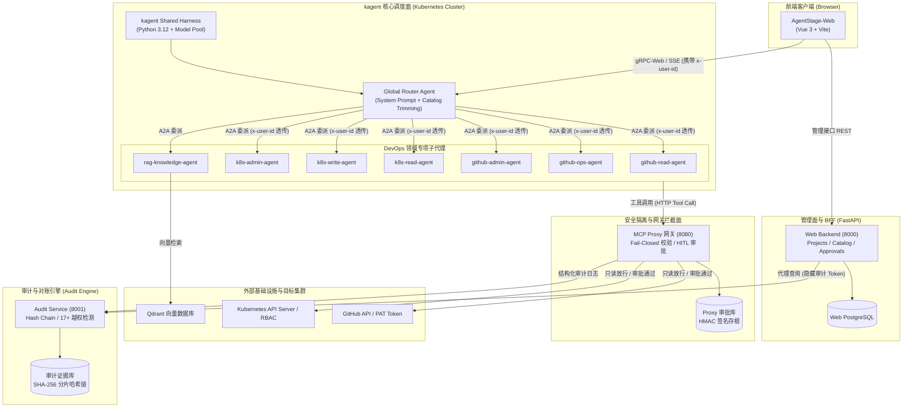
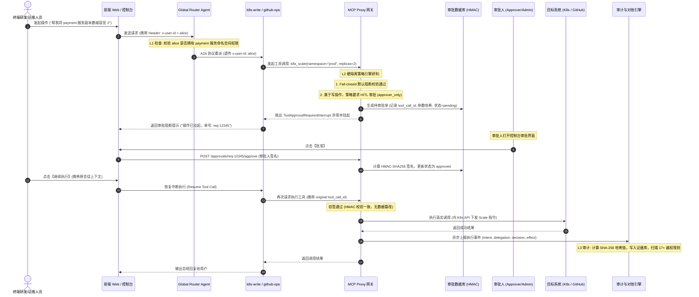

# AgentStage 平台架构与工程洞察报告

> **定位**：基于 **kagent v1.0.0-alpha6 / rc1** 的多租户企业级 DevOps AI Agent 平台  
> **报告对象**：研发/架构 Lead  
> **审查仓库**：
> - 后台与管控核心：`AgentStage`（kagent Harness / Router / MCP Proxy / Audit Service / RAG Engine）
> - 前台与业务后端：`AgentStage-Web`（Vue 3 + Vite 前端 + FastAPI 业务后端）
> **生成日期**：2026-11-03

---

## 目录

1. [执行摘要与平台核心定位](#一执行摘要与平台核心定位)
2. [业务功能全貌（Feature Map）](#二业务功能全貌feature-map)
3. [系统整体架构与数据流向](#三系统整体架构与数据流向)
4. [核心安全护城河：三层纵深防御体系](#四核心安全护城河三层纵深防御体系)
5. [团队技术亮点与工程成效](#五团队技术亮点与工程成效)
6. [Lead 架构审查与演进建议（Roadmap）](#六lead-架构审查与演进建议roadmap)

---

## 一、执行摘要与平台核心定位

### 1.1 平台在解决什么核心问题？
传统的 AI Agent 平台往往直接让 LLM 携带高权限操作外部基础设施（如执行 `kubectl delete` 或直接 Push 代码到主干分支），存在**不可预测的越权、模型幻觉、误操作与审计真空**等重大合规与生产隐患。

**AgentStage 的核心定位**：在开放自由的大模型智能调度（kagent）与企业严肃的生产安全边界之间，建立一套**“端到端身份透传、物理级拦截阻断、人机协同（HITL）审批与防篡改对账”**的综合管控体系。

### 1.2 关键指标与架构规模
- **架构范式**：从单体声明式 Agent 演进为 kagent v1.0 的 `Harness + AgentTemplate + Agent` 三件套；
- **子代理矩阵**：1 个全局入口 Router 调度 + 6 个 DevOps 专项代理（GitHub 读/写/管、K8s 读/写/管）+ 1 个 DevOps 向量知识库（Qdrant + RAG）；
- **防御纵深**：L1 软控（Prompt 约束与目录裁剪）+ L2 硬控（MCP Proxy 网关物理拦截与双模式审批）+ L3 审计（PostgreSQL 分片哈希链防篡改与 17+ 越权检测规则）。

---

## 二、业务功能全貌（Feature Map）

平台由 **前台工作台（AgentStage-Web）** 与 **后台管控及基础设施（AgentStage）** 协同构成：

### 2.1 智能对话工作台（AgentStage-Web / Frontend & Backend）
- **ChatGPT 风格的项目（Projects）与会话管理**：
  - 会话支持归属到自定义项目，并可配置专属系统提示词（Custom Prompt）、图标与色彩主题；
  - 支持多维标签打标（`tags: ["bug", "urgent"]`）、会话置顶（`is_pinned`）以及侧边栏树形聚合接口；
  - 自动从 HTTP Header（`x-user-id`、`X-Kagent-User-ID`）或 Bearer JWT 中识别当前用户，天然租户隔离。
- **管理后台（Admin Console）**：
  - **Service Catalog（服务目录）**：为每个用户/团队分配可操作的目标仓库（GitHub Owner/Repo）与集群命名空间（Namespace）；
  - **Role & User Management（用户与角色管理）**：支持外部系统独立角色分配（`reader` 只读、`writer` 读写、`admin` 管理员、`approver` 审批者）；
  - **Approvals（审批中心）**：普通用户查看自己的审批单进度，审批者/管理员集中审核危险变更；
  - **MCP Tools（工具权限与审批模式配置）**：动态配置每个外部工具的操作性质（只读 / 可逆变更 / 持久写入）与审批模式；
  - **Audit Console（审计控制台）**：概览统计、违规发现（Findings）、事件流水（Events）、调用链链路追踪（Traces）与哈希链健康度监控。

### 2.2 智能编排与领域专项代理（AgentStage / kagent）
- **Global Router Agent**：顶层请求分发中心。基于用户绑定的服务目录与角色上下文，智能识别意图并路由给共享子代理；
- **GitHub 专项代理矩阵**：
  - `github-read-agent`：只读拉取 Issues、PRs、文件树与 CI 运行状态；
  - `github-ops-agent`：日常运维操作（新建 Issue、创建/更新 PR、分支创建、添加评论等）；
  - `github-admin-agent`：高危仓库级管理（创建/Fork 仓库、配置 Ruleset、管理 Collaborators）；
- **Kubernetes 专项代理矩阵**：
  - `k8s-read-agent`：集群只读查询（Pod 状态、日志拉取、Events 事件、YAML 导出、网络连通性排查）；
  - `k8s-write-agent`：应用变更（YAML Apply、Patch 补丁、Pod 重启、Scale 伸缩、Delete 删除）；
  - `k8s-admin-agent`：集群管理员工具（Pod Exec 容器内调试命令执行、集群配置下发）；
- **DevOps 向量知识库（RAG Service）**：
  - 整合企业 DevOps 最佳实践、CI/CD 流水线标准、SRE 故障应急 Runbook 与 SLA 模板；
  - 基于 Qdrant 向量库与 SiliconFlow 嵌入模型，向 Agent 提供即时检索工具。
---

## 三、系统整体架构与数据流向

### 3.1 总体架构拓扑图



### 3.2 典型调用全链路（以创建 PR / Apply YAML 为例）



---

## 四、核心安全护城河：三层纵深防御体系

平台将安全合规要求深植于 Agent 的每个环节，而不是单点校验。

```
+--------------------------------------------------------------------------+
|  L1 软控防线 (Prompt 约束与意图裁剪)                                     |
|  - System Prompt 强绑定 Service Catalog 权限边界                         |
|  - 只读角色绝不委派写/管子代理；无 K8s 写权强行引导走 GitHub PR (GitOps)  |
+--------------------------------------------------------------------------+
                                  |
                                  v
+--------------------------------------------------------------------------+
|  L2 硬控防线 (MCP Proxy 物理隔离与人机审批) [最核心防线]                  |
|  - 独立反向网关，Fail-Closed 默认阻断，未知角色/未声明工具一律拒绝        |
|  - 双模式 HITL 审批：低风险自审 (self_or_approver)，高风险强制换人      |
|  - 防篡改签名：HMAC-SHA256 签名存根，防止运维/黑客直接篡改数据库审批状态 |
+--------------------------------------------------------------------------+
                                  |
                                  v
+--------------------------------------------------------------------------+
|  L3 审计验证防线 (不可篡改证据库与越权检测引擎)                           |
|  - 基于 PostgreSQL 分片的 SHA-256 哈希链 (Hash Chain)，完整保真           |
|  - 17+ 越权规则实时检测：识别绕过 Proxy 影子操作、模型幻觉自编造假写等   |
|  - 前端通过 Web Backend 代理安全访问审计服务，隐藏底层 Query Token        |
+--------------------------------------------------------------------------+
```

### 4.1 L1 软控防线：模型输入层意图过滤
- **目录裁剪（Catalog Trimming）**：Router 在收到请求后，先通过 `x-user-id` 查询其允许操作的应用清单（如仅限 `infra/cluster-dev`），并在 System Prompt 中明确注入受限边界；
- **意图降级与安全引导**：当只读角色（Reader）要求“重启 Pod”时，Router 不会拒绝服务，而是引导用户“已为你生成对应 GitOps 仓库的 PR 草稿，请提交 PR 触发合并流程”；
- **防虚构约束**：严格禁止子代理在缺乏上下文时自行编造虚构的 Pull Request 标题、Commit Hash 或 Issue 编号。

### 4.2 L2 硬控防线：MCP Proxy 网关与物理级阻断
- **Fail-Closed 默认阻断原则**：
  - 角色不在白名单内：立即返回 403 Forbidden；
  - 请求的 Tool 不在服务目录声明的工具池中：直接拒执行；
  - 参数越权（如操作未经授权的 Namespace 或 Repository）：直接阻断。
- **双模式人机协同（HITL）审批机制**：
  1. `self_or_approver`（低/中风险操作，如开发测试环境部署、重启单个 Pod）：发起人自己确认或审批人确认均可执行；
  2. `approver_only`（高风险操作，如生产环境 Scale、Delete 资源、合并保护分支）：**严格强制发起人回避**（Requester != Approver），必须由具备 `approver` 或 `admin` 角色的第三方人员介入批准。
- **密码学防篡改签名（HMAC-SHA256）**：
  - 当审批单被批准时，Proxy 使用服务器内部的私有密钥 `APPROVAL_SIGNING_KEY` 对 `tool_call_id + user_id + tool_name + arguments_hash + approved_at` 生成 HMAC 散列；
  - 当子 Agent 恢复执行并请求放行时，Proxy 重新计算 HMAC 并与数据库中的存储值进行比对。**即使拥有数据库写权限的黑客直接在 SQL 中把 `status` 改为 `approved`，也会因为无法伪造 HMAC 签名而遭到坚决拦截**。

### 4.3 L3 审计验证防线：全链路证据链与 17+ 越权规则引擎
- **哈希链（Hash Chain）防篡改**：每个新上报的事件其 `prev_hash` 都指向前一个事件的 `hash`，类似于区块链的密码学结构。一旦有人在数据库中篡改历史记录，整条链条将在审计对账时报警断裂；
- **四维证据链对账**：
  - `intent.declared`（用户原始输入意图）
  - `agent.delegated`（Router 实际委派的子代理与参数）
  - `proxy.decided`（MCP Proxy 的策略裁决与审批单记录）
  - `effect.observed`（底层目标系统观测到的真实操作结果）
- **17+ 越权审计规则库**：
  - 检测“只读意图却发生了写委派”；
  - 检测“无审批单却存在 Proxy 放行”；
  - 检测“绕过 Proxy 网关直接发生在底层云平台的外部影子变更（Shadow Action）”；
  - 检测“Agent 谎报执行成功（模型幻觉自编造结果）”。

---

## 五、团队技术亮点与工程成效

团队在过去几个迭代中的技术积累非常扎实，尤其体现在以下四个维度：

1. **架构升级极具前瞻性（拥抱 kagent v1.0）**：
   - 团队果断从旧版独立声明式单体 Agent 迁移至 kagent v1.0 的 `Harness + AgentTemplate + Agent` 体系。
   - 所有子 Agent 共享同一个 Harness Pod 运行时，大幅节省了集群内存和 CPU 开销，并且原生打通了通过 A2A Header（`x-user-id`）逐级透传终端用户身份的能力。

2. **严密的凭证隔离与工程安全素养**：
   - 近期代码中将原先在配置文件中偶现的 GitHub PAT、PostgreSQL 密码与 HMAC 密钥全面剥离，改为通过 Kubernetes Secret 与运行时环境变量安全挂载；
   - 实现了基于 HMAC 的审批单防篡改与换人审批硬约束，安全标准对标金融及合规认证。

3. **极其详尽的设计文档与 POC 实验闭环**：
   - 平台沉淀了 17+ 篇长文架构设计文档（如《多用户门户总体设计》、《A2A 身份透传与统一链路》、《多 Agent 审计与越权检测》、《MCP 审批模式》等），不仅有架构图，还有详细的协议抓包分析与异常推演，在新兴 AI 工程团队中非常罕见。

4. **清晰的前后端分层与解耦**：
   - 将早期的单体 Portal 彻底重构为标准的前后端分离架构（Vue 3 + Vite 前端，FastAPI 业务管理后端）。
   - 前端向用户展示审计数据时，完全不接触底层的只读 Token，全部通过 Web Backend 安全代理，避免了内网安全边界外泄。

---

## 六、Lead 架构审查与演进建议（Roadmap）

作为技术 Lead 角色，从生产稳定性、合规演进与工程体验三个维度，梳理出以下具备高回报率的重构与改善建议：

| 优先级 | 影响领域 | 问题与风险现状 | 建议实施方案 |
| :--- | :--- | :--- | :--- |
| **P0 (最高)** | **通信协议稳定性**<br/>`AgentStage-Web/src/api/grpc.ts` | 目前前端直接通过手写 Varint 和字节拼接方式构造 gRPC-Web 二进制帧与 kagent 建立连接。kagent 仍处于频繁迭代期，一旦上游 Protobuf 字段或消息结构变更，手写解析极易静默崩溃且难于排查。 | **收敛至 Backend BFF 模式**：前端只调用 `AgentStage-Web/backend`（FastAPI），后端使用官方 `protoc` 生成的强类型 Client 与 kagent 通信，并以标准的 **SSE (Server-Sent Events)** 格式向前端流式吐出。同时彻底将 Token 从浏览器端消除。 |
| **P0 (最高)** | **生产级密钥轮转**<br/>`mcp_proxy/core/approval.py` | 目前审批单 HMAC 签名依赖单一的环境变量 `APPROVAL_SIGNING_KEY`。在企业生产运维定期轮换密钥时，所有历史审批单将因为无法验签而报“数据篡改”。 | **引入 Key Versioning 机制**：在 `proxy_approvals` 表中增加 `key_version` 字段。配置中支持当前主密钥与历史有效密钥列表（`ACTIVE_KEY_VERSION` + `SIGNING_KEYS` Map），支持无感平滑轮转。 |
| **P1 (重要)** | **审计效果面对账**<br/>`audit_service/connectors` | 目前 P0 审计链路完成度约 98%，但真实效果面对账（P1）仅完成约 35%。如果内部运维通过堡垒机直接 `kubectl` 操作生产环境，审计系统难以自动发现与 Proxy 记录的偏差。 | **接入外部连接器（Connectors）**：补齐 GitHub Webhook 监听器与 Kubernetes 审计日志订阅器，自动生成 `effect.observed` 事件流，与 Proxy 的 `proxy.decided` 进行差异对账，告警“影子操作”。 |
| **P1 (重要)** | **模型容错与降级**<br/>`AgentStage/agent_yaml` | 部分大模型在特定场景下直连调用 Tool 时，会发生格式解析异常或拒绝委派的偶发错误，导致任务直接失败中断。 | **增加 LLM Fallback 模型池**：在 AgentTemplate 配置中允许指定备用模型（如主选模型超时或格式异常 2 次后，自动无缝降级到稳定版本模型重试当前步骤）。 |
| **P2 (工程)** | **新人开发微环境**<br/>仓库根目录工程规范 | 单元测试和集成脚本分散在各个目录（`test_schema.py`、`test_policy.py`、`e2e_write_test.py` 等），缺乏一条命令拉起本地测试依赖的体验。 | **统一 Makefile 与 Docker Compose**：根目录增加 `Makefile`（提供 `make test`、`make lint`、`make dev`），配套 `docker-compose.local.yml`（一键起轻量 PG 与 Mock MCP Server），组内新人 5 分钟可拉起全套本地开发验证。 |

---

## 七、总结

AgentStage 展现了非常出色的企业级 AI 工程化落地思路：**它不仅利用了 kagent 的多 Agent 协同能力，更关键的是在 Agent 背后筑牢了以 MCP Proxy 为代表的确定性安全栅栏。**

按照上述 Roadmap 完成 P0（BFF 收口与密钥版本化）和 P1（外部效果面对账），平台即可从目前的“准生产/高级 POC 阶段”平滑跃升为“企业生产级核心运维底座”。

